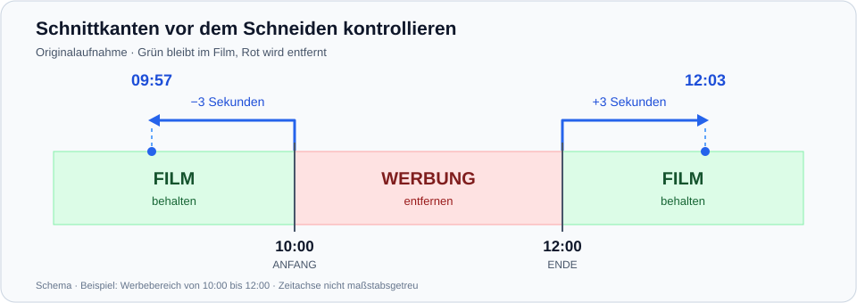

# Cut Assistant Next

Aktuelle öffentliche Vorabversion vom 12.10.2026: **0.2.1 · Build 16 · RC3** mit optionalem Motor **otr-can 0.1.5**. [Setup, Portable-ZIP, Quellen und Prüfsummen](https://github.com/jmagull/cut-assistant-next/releases/tag/v0.2.1-build16-rc3) sind verfügbar. Build ohne Warnungen/Fehler, **793/793 CAN-Tests und 44/44 Rust-Tests** bestanden; alle sieben Uploads anhand ihrer Größen und GitHub-SHA-256-Digests geprüft. [Veröffentlichungsnachweis](docs/RELEASE-PUBLICATION-BUILD16-RC3.md).

Lokaler Entwicklungsstand seit 13.10.2026: **0.3.0 · Build 29 · RC3** ergänzt die neue Schaltflächenreihenfolge, frei editierbare Filmnamen, direktes Speichern von Film/Cutlist, getrennte Serienbausteine, gemeinsame Bereichsauswahl, die Rechtsklick-Schnittkontrolle **−3/+3 Sekunden** im Original und einen unabhängigen Kontrollplayer für fertige Übergänge. **1076/1076 CAN-Tests** und WPF-Prüfungen mit echten libmpv-Instanzen bestanden. Die [Gesamtabnahme](docs/GESAMTABNAHME-BEDIENUNG-20261012.md) enthält acht erfolgreiche reale synthetische Schnittaufträge und einen offenen MP4Box-Befund bei einer Datei mit zwei gleichartigen AAC-Spuren; die Bedienrunde aus Build 24 ist inzwischen vom Nutzer positiv geprüft, einschließlich beider Motoren und Original-AVI. Build 25 erweitert den Kontrollplayer um Anfang und Ende; diese Funktion ist ebenfalls persönlich positiv geprüft. Build 26 ermöglicht in der Frame-Lupe bei erkanntem AVI ohne Original-PTS die Vorschau und Kantenübernahme über einen ausdrücklich gekennzeichneten, bildgeprüften rekonstruierten Zeitstempel. [AVI-Lupenprüfung und Grenzen](docs/AVI-FRAME-LUPE-20261013.md). Der Nutzer bestätigt die AVI-Lupe und den Teufelsbrigade-Schnitt mit beiden Verfahren als erfolgreich, jeweils ohne Blitzer. Build 27 setzt „Suchsprung nur bei Richtungswechsel halbieren“ um und ergänzt **Prüfen** unter FFmpeg-Werkzeuge: Versionen **größer als 5.1** erforderlich, **ab 9.0.2** empfohlen. [Prüfbericht](docs/LUPEN-SUCHRICHTUNG-FFMPEG-20261013.md). FFmpeg-Versioncheck, Richtungswechsel-Halbsprung und alternative Folgennomenklatur sind persönlich bestätigt. Build 28 erklärt die von Hand ergänzten Staffel-/Folgenwerte direkt an der Maskenvorschau. Build 29 verwendet nach einer gespeicherten Maskenänderung beim bewussten Neuerzeugen im Cutlist-Dialog sofort die aktuelle Maske, auch bei bereits geladener Datei und ohne Neustart. [Maskenwechsel-Prüfung](docs/NAMENSMASKE-OHNE-NEUSTART-20261013.md). [Aktueller Prüfstand](docs/KONTROLLPLAYER-ANFANG-ENDE-20261012.md). Öffentliche Build-16-Pakete enthalten diese Bedienungsänderungen noch nicht. [Film-Ausgabe](docs/AUSGABENAME-DIREKTSPEICHERN-20261012.md), [Cutlist-Speichern](docs/CUTLIST-AUTOSPEICHERN-20261012.md), [Namensmasken](docs/NAMENSMASKEN-EINZELBAUSTEINE-20261012.md), [Bereichsauswahl](docs/SCHNITTBEREICH-AUSWAHL-20261012.md), [Schnittkontrolle](docs/SCHNITTKONTROLLE-3SEK-20261012.md), [Kontrollplayer](docs/SCHNITTUEBERGAENGE-KONTROLLPLAYER-20261012.md).

Eingefrorener Paketsatz vom 13.10.2026: **0.3.0 · Build 29 · RC3** aus Quellcommit **ce4bc15b118d8080a78d7db5396db3ccf830ca89**, mit unverändertem **otr-can 0.1.5**. Setup, Portable-ZIP, passende CAN-/Motor-/libmpv-Quellen und SHA-256-Prüfsummen liegen lokal unter rtifacts/release-build29-RC3. **1076/1076 Pakettests**, **249 Portable-Dateien** und **509 Quellen-ZIP-Dateien** geprüft. [Paketprüfbericht](docs/RELEASE-BUILD29-RC3-RESULT.md). Persönliche Installations-/Portable-Paketabnahme folgt; die öffentliche Build-16-Ausgabe bleibt unverändert.

Cut Assistant Next (CAN) ist ein Windows-Programm zum Abspielen von Videos, Bearbeiten klassischer Cutlists und Schneiden mit MP4Box oder dem optionalen otr-can. Die Oberfläche verwendet WPF und mpv/libmpv, ohne DirectShow oder installierte Windows-Codec-Pakete vorauszusetzen.

CAN ist weiterhin ein Proof of Concept. Geeignete H.264-AVI-Dateien können für beide Motoren experimentell ohne Neukodierung der Streams nach MP4 umgepackt werden. otr-can 0.1.5 dekodiert MP3, schneidet den Ton als PCM und kodiert ihn danach **einmal nach AAC-LC**; eine zusätzliche AAC-Vorkodierung entfällt. Die Tonkodierung bleibt verlustbehaftet. Bestehende AAC-/AC3-Abläufe bleiben erhalten. MP4Box bleibt Standard. Direkt unter der Schnittliste wählst du den Motor für diesen Auftrag.

Frische Setup-Installation in der VM, beide Motoren, Deinstallation und Portable-ZIP in der VM mit beiden Motoren sind vom Nutzer positiv bestätigt. Ein Setup-AVI-Ergebnis wurde außerdem an Anfang, Ende, allen Schnittübergängen sowie auf Bild und Ton persönlich abgenommen. Der bekannte technische Video-PTS-Befund bleibt offen; AVI bleibt experimentell. [Paketprüfbericht](docs/RELEASE-BUILD16-RC3-RESULT.md), [AVI-/MP3-Prüfbericht](docs/AVI-OTR-CAN-MP3-20261012.md) und [gesicherte Quellen](docs/QUELLSTAND-BUILD16-RC3-20261012.md) beschreiben Prüfstand und Grenzen.

Die vorherige [Build-13-RC3-Ausgabe](https://github.com/jmagull/cut-assistant-next/releases/tag/v0.2.1-build13-rc3) und frühere Releases bleiben verfügbar. Die ältere AAC-/AC3-Erprobung steht im [Radical-Korrekturbericht](docs/OTR-CAN-RADICAL-KORREKTUR-20261011.md). Weitere reale Formate und getrennte Tonspurkontrollen folgen vor Version 1.0.

## Lizenz

Der vom CAN-Projekt selbst entwickelte Quellcode steht unter **GPL-3.0-or-later**. Der vollständige Lizenztext steht in [LICENSE](LICENSE). Eingebundene Bibliotheken, NuGet-Pakete und die .NET-Laufzeit behalten ihre eigenen Lizenzen; die [libmpv-Hinweise](docs/libmpv/v0.41.0/THIRD-PARTY-NOTICES.md) und die [.NET-/NuGet-Bestandsaufnahme](docs/DOTNET-LICENSING.md) ordnen sie zu. Die öffentliche RC3-Ausgabe ist als Vorabversion gekennzeichnet; die zugehörigen Quellen und Prüfsummen stehen beim Release.

## Danksagung

CAN baut auf Ideen und Arbeit vieler Menschen und Projekte auf. Die [Danksagung](docs/DANKSAGUNG.md) nennt die Beteiligten und würdigt auch die KI-unterstützte Entwicklung.

## Einstieg

- [Nutzeranleitung](docs/NUTZERANLEITUNG.md): Einrichtung, Bedienung, Cutlists, Schneiden und Hilfe bei Fehlern.
- [Projektstatus](docs/STATUS.md): umgesetzter Umfang, bestätigte Tests und offene Aufgaben.
- [Entwicklungstagebuch](docs/TAGEBUCH.md): aktuelle Änderungen, Prüfergebnisse und offene Schritte.
- [Setup-Merkliste](docs/SETUP-MERKLISTE.md): geplantes Gesamtpaket und vorgemerkte V2-Funktionen.
- [Testplan](docs/TESTPLAN.md): reproduzierbare Prüfungen und Testbasis.
- [Build-16-RC3-Prüfbericht](docs/RELEASE-BUILD16-RC3-RESULT.md): gesicherter Quellcommit, technische Prüfungen und persönliche Setup-/VM-/Portable-Abnahme.
- [RC2-Prüfbericht](docs/RELEASE-BUILD7-RC2-RESULT.md): Quellstand, Paketprüfsummen, 496 automatisierte Tests, Portable-Starttest und verbleibende Praxistests.
- [RC3-Veröffentlichungsnachweis](docs/RELEASE-PUBLICATION-BUILD16-RC3.md): Quelltag, sieben öffentliche Downloads und geprüfte GitHub-Digests.
- [Früherer RC2-Veröffentlichungsnachweis](docs/RELEASE-PUBLICATION-BUILD7-RC2.md): Build 7 und dessen persönliche Paketprüfung.
- [Architektur](docs/ARCHITECTURE.md) und [Entscheidungen](docs/DECISIONS.md): technische Hintergründe und Entwicklungsgeschichte.

## Was CAN derzeit kann

- Videos laden, mit ffprobe analysieren und mit mpv wiedergeben.
- Play/Pause, Seeking, Einzelbildschritte und Lautstärkeregelung.
- Zu entfernende Bereiche markieren, auswählen, korrigieren und löschen.
- Eine angeklickte Schnittkante mit Umschalt+F in der Frame-Lupe prüfen, Framedetails und Keyframes anzeigen und den ausgewählten Frame als neue Kante übernehmen.
- Zusätzlich zur Navigation mit ±1/±10 Frames mit halbierten Suchsprüngen navigieren: standardmäßig 2000, 1000, 500 … bis 1 Frame, mit einstellbarem Startwert und Neustart.
- Cutlists lokal laden, erzeugen und speichern.
- Passende Server-Cutlists automatisch suchen und die Suche erneut per Button öffnen.
- Lokal gespeicherte Cutlists nach Bestätigung auf den konfigurierten Server hochladen.
- Fremde Cutlists als Vorlage verwenden, deren Namensvorschlag bewusst beibehalten oder neu erzeugen und die Herkunft bei abweichendem Autor im Kommentar dokumentieren.
- Schnittzeiten einheitlich anzeigen und die Namensvorschau markieren und kopieren.
- Ausgabenamen über Namensmasken und Cutlist-Namensvorschläge vorbereiten.
- MP4-Inhalte direkt mit MP4Box schneiden, auch bei abweichender Dateiendung.
- Andere Container nach Bestätigung experimentell mit FFmpeg verlustfrei nach MP4 umpacken und anschließend mit MP4Box schneiden.
- Optional mit OTR-CAN aus geeigneten MP4-Dateien oder experimentell vorbereiteten H.264-AVI-Dateien schneiden, FFMS2 einmal indexieren und unterstützte Tonspuren übernehmen; CPU-Encoding an Video-Schnittgrenzen und vollständige Audio-Neukodierung, bei MP3 einmal nach AAC-LC.
- Fortschritt und Protokoll anzeigen, kopieren und den Vorgang abbrechen.
- Hauptfenster und die vier Schnittdialoge (Schneiden, Fortschritt/Protokoll, Abschluss, Cutlist erzeugen) merken Größe und Maximierung; die Player-Lautstärke wird ebenfalls gespeichert. Inhalte bleiben bei kleinen Fenstern scrollbar.

Die reine Cutlist-Erstellung benötigt keine Video-Umwandlung. Erst beim Schneiden wird eine gegebenenfalls notwendige MP4-Arbeitsdatei erzeugt. Serversuche und Cutlist-Zuordnung beziehen sich dabei weiterhin auf die Originaldatei.

## Schnittkanten vor dem Schneiden kontrollieren

Ab dem lokalen Build 22 kannst du im Originalplayer die Umgebung einer Schnittkante per Rechtsklick prüfen:



Rechtsklick auf Anfang: 3 Sekunden zurück. Rechtsklick auf Ende: 3 Sekunden vorwärts. So lassen sich die Filmszenen unmittelbar vor und nach einem Schnittbereich kontrollieren.

Dateigrenzen und sehr kurze angrenzende Filmabschnitte begrenzen den Sprung. Auswahl und Schnittwerte bleiben erhalten; die Wiedergabe startet nicht automatisch. Anschließend kannst du die vorhandene Frame-Lupe zur Korrektur verwenden.

## Schnittübergänge nach dem Schneiden prüfen

Ab dem lokalen Build 25 öffnet **Prüfen** neben Anfang, jedem Übergang und Ende im Abschlussfenster die fertige Datei in einem eigenen CAN-Kontrollplayer, auch bei nur einem Behalteabschnitt. Am Anfang startet die Wiedergabe bei 0:00, vor einem Übergang drei Sekunden davor und am Ende drei Sekunden vor der tatsächlich geladenen Filmdauer. Sehr kurze Filme beginnen bei 0:00. **Vorherige Prüfstelle** und **Nächste Prüfstelle** wechseln zwischen allen Kontrollstellen. Play/Pause, Positionsregler und eigene Lautstärke stehen bereit. Das Fenster wird wiederverwendet; Originalplayer und Schnittliste bleiben erhalten. Bitte auch Anfang, Ende, Bild, Ton und Tonsynchronität prüfen. [Bedienung und Prüfgrenzen](docs/SCHNITTUEBERGAENGE-KONTROLLPLAYER-20261012.md).

## Grenzen

MP4 ist ein Container, keine Bezeichnung für einen bestimmten Videocodec. Ob sich ein anderes Format verlustfrei vorbereiten lässt, hängt von seinen Streams ab. Die MP4Box-Vorbereitung verwendet Stream-Copy. Der optionale OTR-CAN-Motor kopiert geeignete IDR-Abschnitte, kodiert Video-Schnittgrenzen und jede vollständige Tonspur auf der CPU neu. Ungeeignete Dateien oder deutliche Abweichungen werden mit einer Fehlermeldung gestoppt.

Die Prüfung der Arbeitsdatei ist eine Plausibilitätsprüfung anhand der Medieninformationen. Sie ersetzt nicht die Kontrolle der Schnittstellen und der Ton-Synchronität. OTR-CANs Video-Smart-Rendering und Audio-Neukodierung sind synthetisch und mit Pines geprüft; Stapelverarbeitung und integrierte mehrteilige Aufnahmen sind noch nicht umgesetzt.

Insbesondere bei historischen AVI-Dateien können bereits im Original Probleme mit Zeitstempeln, Bildaktualisierung oder Ton-Synchronität auftreten. Eine irreführende Dateiendung wie `.avi.mp4` ändert nichts am tatsächlich erkannten Container. CAN zeigt bei tatsächlich erkanntem AVI bereits nach dem Laden einen gelben Hinweis auf mögliche Probleme im Original; eine abweichende Dateiendung wird zusätzlich erklärt. Weitere Praxistests erfolgen mit geeigneten neuen Aufnahmen.

Die Gesamtabnahme in Build 24 hat bei einer erzeugten Datei mit zwei gleichartigen AAC-Stereo-Spuren einen MP4Box-Zusammenfügungsfehler reproduziert, auch direkt mit GPAC 26.07. CAN veröffentlicht dabei keine fertige Ausgabe. Der AAC/AC3-Fall funktioniert; eine allgemeine Ursache oder Aussage über alle Mehrspurdateien ist noch nicht belegt. [Nachweis und Prüfgrenzen](docs/GESAMTABNAHME-BEDIENUNG-20261012.md).

## Für Anwender

Vorgesehene Umgebung ist Windows 11 x64. Die öffentliche RC3-Vorabversion bietet Setup und Portable-ZIP sowie den optionalen Motor otr-can 0.1.5. Die .NET 10 Desktop Runtime muss separat installiert werden; die vier geprüften libmpv-DLLs sind enthalten. ffprobe, FFmpeg und MP4Box werden separat installiert und über die Einstellungen konfiguriert.

Die [Nutzeranleitung](docs/NUTZERANLEITUNG.md) erklärt die Einrichtung ohne Entwicklungswerkzeuge.

## Aus dem Quellcode bauen

Voraussetzungen: Windows 11 x64, .NET-10-SDK und die vier DLLs des [geprüften CAN-libmpv-0.41.0-Kandidaten](docs/libmpv/v0.41.0/README.md) in einem lokalen Ordner. Das Setup-Skript prüft die SHA-256-Werte und kopiert die DLLs in den ignorierten Laufzeitordner. Ein .NET-Restore benötigt die passenden Pakete im lokalen Cache oder Netzwerkzugriff.

Im Repository-Verzeichnis:

```powershell
.\tools\setup-libmpv.ps1 -SourceDirectory 'C:\Pfad\zum\Vier-DLL-Ordner'
dotnet restore .\CutAssistantNext.sln
.\tools\build.ps1 -Configuration Release -NoRestore
dotnet test .\CutAssistantNext.sln --configuration Release --no-build
```

Die Anwendung liegt danach unter `src\CutAssistantNext.App\bin\Release\net10.0-windows\CutAssistantNext.App.exe`. Der Build kopiert die vier vorbereiteten DLLs und die Drittanbieterhinweise in das Ausgabeverzeichnis. Für Analyse, experimentelles Umpacken und Schnitt sind zusätzlich die konfigurierten externen Werkzeuge erforderlich.

## Version und Buildnummer

Aktuelle öffentliche Vorabversion vom **12.10.2026: 0.2.1 · Build 16 · RC3**, Release-Build ohne Warnungen/Fehler, **793/793 CAN-Tests und 44/44 Rust-Tests bestanden**. Setup, Portable, CAN-/Motorquellen, libmpv-Quellen-/Relink-Pakete und Prüfsummen stehen beim [Release](https://github.com/jmagull/cut-assistant-next/releases/tag/v0.2.1-build16-rc3) bereit. Alle sieben Uploads stimmen mit den lokalen Größen und SHA-256-Werten überein. Frische VM-Setup-Installation, beide Motoren, Deinstallation und Portable mit beiden Motoren persönlich bestätigt; ausführliche Setup-Filmabnahme dokumentiert. Überinstallation und frisches Portable-Profil nicht gesondert bestätigt. Frühere Releases bleiben unverändert verfügbar.

Öffentliche Vorabversion vom 01.10.2026: **0.2.1 · Build 7 · RC2** mit korrigierter Upload-Identität und überarbeiteten Cutlist-Einstellungen. Der Release-Build ist ohne Warnungen oder Fehler abgeschlossen; **496/496 Tests bestanden**. Setup, Portable-ZIP, Quellen und Prüfsummen stehen beim Release bereit. Die frühere Ausgabe **0.2.0 Build 6 – RC2** bleibt unverändert verfügbar.

Die inhaltliche Version steht zentral in `Version.props`: Patch für Korrekturen, Minor für neue Funktionen, Major für einen größeren Versionssprung. Sie wird bewusst gepflegt.

Die RC-Kennung steht ebenfalls in `Version.props` (`CanCandidate`, derzeit `RC3`) und erscheint auch bei normalen lokalen Builds im Fenstertitel und in der Hauptüberschrift. Eine ausdrücklich übergebene Build-Eigenschaft `CanCandidate` hat Vorrang. Die numerische Version für Cutlists und HTTP-Uploads enthält diese Kennung nicht.

`tools/build.ps1` baut die gesamte Lösung neu und erhöht den lokalen Zähler in `.build/build-number.txt` genau einmal bei erfolgreichem Abschluss. Fehlgeschlagene Builds erhöhen ihn nicht. Titel, Hauptüberschrift und Dateieigenschaften verwenden dieselbe Version und Buildnummer. Einzelne Projekt-Builds und direkte IDE-/dotnet-Builds verwenden die zuletzt erfolgreiche Nummer (bei einem neuen Checkout zunächst 0); für eine neue nummerierte Ausgabe das Skript verwenden. Der Zähler ist lokal, wird nicht mit Git synchronisiert und identifiziert keine weltweit eindeutige Veröffentlichung. Gleichzeitige Skript-Builds im selben Checkout werden durch eine Dateisperre verhindert.

## Projektstruktur

| Bereich | Aufgabe |
|---|---|
| `src/CutAssistantNext.App` | WPF, Dialoge, ViewModels, Einstellungen und Ablaufsteuerung |
| `src/CutAssistantNext.Core` | Medienmodelle, Schnittplan, Namensbildung und Verträge |
| `src/CutAssistantNext.Media` | ffprobe, mpv und Prozessausführung für FFmpeg/MP4Box |
| `src/CutAssistantNext.Cutlists` | Cutlist-Import, Export, Metadaten und Bereichsumrechnung |
| `tests` | vier automatisierte Testsuiten |
| `samples` | kleine Referenzdaten |
| `tools` | Einrichtung von libmpv und versionierte Builds |
| `docs` | Anleitung, Status, Testplan und technische Dokumentation |

Historischer RC2-Release-Stand (01.10.2026): **0.2.1 Build 7 – RC2**, Release-Build ohne Warnungen oder Fehler und **496/496 automatisierte Tests bestanden**. Alle 148 Dateien des Portable-ZIPs wurden geprüft; Start, Versionsanzeige und reguläres Beenden waren erfolgreich. Die Installation in einer VM und ein dreiteiliger HQ-MP4-Schnitt von „Grey’s Anatomy – Durchs Feuer“ wurden bestätigt; Bild und Ton der fertigen Datei waren einwandfrei. Die Setup-Deinstallation wurde ebenfalls als erfolgreich bestätigt. Der separate Portable-ZIP-Schnitt mit drei Behaltebereichen wurde ebenfalls erfolgreich abgeschlossen; Bild und Ton der fertigen Datei wurden vom Benutzer als einwandfrei bestätigt. Details stehen im [damaligen Prüfbericht](docs/RELEASE-BUILD7-RC2-RESULT.md); die früheren Pakettests bleiben im [Build-6-Prüfbericht](docs/RELEASE-BUILD6-RC2-RESULT.md) dokumentiert.
