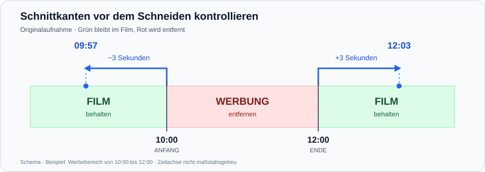

# Cut Assistant Next

## Cut Assistant Next 1.0.3 Build 53 – gemeinsame lokale Prüffassung

Ein maßgeblicher Entwicklungsstand im ursprünglichen Repository **cut-assistant-next**, Branch **codex/integration-build53**. Die geprüfte Audio-Fehlerbehandlung aus Build 52 und die Spotlight-Fensterpersistenz aus Build 50 gehören zu derselben regulär benannten Anwendung. Alte Funktions-Checkouts bleiben unveränderte Quellen; neue Entwicklung erfolgt im kanonischen Repository.

Der normale Audioablauf bleibt streng. Nach einem belegten Tonfehler stehen Abbrechen, bestätigter MP4Box-Neustart und bei passendem Befund ausdrücklich bestätigte AAC-Reparatur oder Tonspur-Abwahl bereit. Der passende Motor wird aus `runtime/otr-can` verwendet; gespeicherte Werkzeugpfade bleiben erhalten. Keine automatische Reparatur oder pauschale Sampletoleranz.

Spotlight unter **Werkzeuge → Spotlight-CAN – Visuelle Werbesuche** übergibt grobe Bereiche an CAN, zeigt Original-/Entfernen-/Restdauer und behält Größe, Position und Maximierung. Mehrmonitor-/DPI-Korrektur hält das Fenster sichtbar. Die Detailsuche hat standardmäßig zwei Sekunden Bildabstand. Den letzten betroffenen Bereich bei Bedarf in CAN mit **Videoende** bis zum tatsächlichen Dateiende abschließen.

Voraussetzungen bleiben Windows 11 x64, .NET 10 Desktop Runtime x64 und die in CAN eingerichteten externen FFmpeg-/ffprobe-/MP4Box-/FFMS2-Werkzeuge. Windows 10 wurde nicht persönlich validiert. Die gemeinsame Fassung ist lokal zur neuen persönlichen Prüfung bestimmt; keine automatische Installation und kein öffentliches Release. Stabil veröffentlicht bleibt 1.0.2 Build 48.

[Integration und Herkunft](docs/INTEGRATION-BUILD53-20261108.md) · [Neue Prüfergebnisse und Startpfad](docs/PRUEFBERICHT-BUILD53-20261108.md) · [Spotlight-README](docs/SPOTLIGHT-README.md).

## Historischer Ausgangsstand: Build 52

Nach einem otr-can-Tonfehler kann CAN eine nachgewiesen beschädigte Tonspur nach ausdrücklicher Bestätigung ausschließen. Alle verbleibenden Tonspuren werden vor dem Angebot auf Decoderfehler und die Zeitabdeckung der Behaltebereiche geprüft. [Bedienung und Prüfgrenzen](docs/AUDIO-SPURABWAHL-BUILD52.md)

Setup, Portable-ZIP und die Quellen einschließlich Spotlight-CAN gehören zum eingefrorenen Paketsatz. Der John-Wick-Tonspur-Dialog, der NCIS-Praxistest und beide Klebecenter-Wege sind persönlich bestätigt. [Pakete, Voraussetzungen und Nachweise](docs/FREEZE-1.0.3-BUILD52.md)

## Historischer Ausgangsstand: Build 51

Lokale Prüffassung für Windows 11 x64 mit integriertem Spotlight-CAN und dem beiliegenden otr-can **0.1.6-audio-diag.1**. Setup, Portable-ZIP, vollständiges CAN-Quellpaket einschließlich Spotlight-CAN sowie ergänzende Motor- und libmpv-Quellen bilden den Paketsatz. [Paketübersicht und Voraussetzungen](docs/PAKETE-BUILD51-20261105.md)

Bei einem Tonfehler kannst du abbrechen, den gesamten Schnitt mit dem eingerichteten MP4Box neu starten oder eine dafür geeignete AAC-Zeitlücke ausdrücklich experimentell reparieren. In **Werkzeuge → Spotlight-CAN – Visuelle Werbesuche** lassen sich Werbeblöcke grob markieren und anschließend in CAN präzisieren. Die Laufzeitanzeige berücksichtigt abgeschlossene Schnittbereiche und zählt überlappende Bereiche einmal. [Audioablauf und Praxistests](docs/AUDIO-DREI-OPTIONEN-20261105.md) · [Spotlight-CAN](docs/SPOTLIGHT-INTEGRATION-20261104.md)

## Historische Audio-Prüffassung – 04.11.2026

**CAN 1.0.3 · Build 50 · Audio-Diagnose-Entwicklung**, Branch codex/audio-diagnostics-fallback auf der unveränderten Spotlight-Integration. Präzisere otr-can-Audiobefunde und ausdrücklich bestätigter vollständiger MP4Box-Neustart; strenge Sampleprüfung bleibt erhalten. Der eigene mitgelieferte Diagnosemotor 0.1.6-audio-diag.1 wird nur in dieser gekennzeichneten Prüffassung verwendet, ohne gespeicherte Motorpfade umzustellen. Keine Veröffentlichung und keine produktive neue Audioreparatur. [Umsetzung, Bedienung und Prüfstand](docs/AUDIO-FALLBACK-PAKET1-20261104.md) · [Paket-2-Konzept](docs/AUDIO-FEHLERBEHANDLUNG-PAKET2-KONZEPT-20261104.md).

Cut Assistant Next ist ein Windows-Programm zum Abspielen von Videos, Bearbeiten klassischer Cutlists und Schneiden mit MP4Box oder otr-can. Es verwendet WPF und mpv/libmpv, ohne DirectShow oder installierte Windows-Codecs.

## Entwicklungsbranch: Spotlight-CAN – 04.11.2026

Im Branch codex/spotlight-integration ist **Werkzeuge → Spotlight-CAN – Visuelle Werbesuche** integriert. Die Komponente nutzt den in CAN geöffneten Film und dessen Werkzeugpfade, übergibt grobe Entfernen-Bereiche direkt und zeigt Original-, Entfernen- und verbleibende Laufzeit. Bestehende Schnitte werden nur nach Bestätigung ersetzt; Präzisierung erfolgt anschließend mit CAN-Player/Frame-Lupe. **Lokale Prüffassung, kein neues stabiles Release.** [Bedienung, Architektur und Prüfergebnisse](docs/SPOTLIGHT-INTEGRATION-20261104.md).

Zum Bauen dieses Branchs zuerst **git submodule update --init --recursive** ausführen; dafür ist Zugriff auf das private Spotlight-CAN-Repository erforderlich. Die eigenständige Spotlight-Anwendung bleibt separat baubar.

## Eingefrorener Entwicklungsstand – 03.11.2026

**CAN 1.0.3, Buildzähler unverändert 48; auf Nutzerauftrag eingefroren.** Quellstand und Dokumentation werden per Commit und Push gesichert. **Veröffentlichung erst nach gesonderter Freigabe; keine neuen Pakete.** [Freeze und Prüfgrenzen](docs/FREEZE-1.0.3-20261103.md). Beim Öffnen eines Films bietet eine gemeinsame Tabelle Server- und lokale Cutlists ohne Vorauswahl an. Lokal wird ausschließlich der exakte Name **Originaldateiname einschließlich Endung + `.cutlist`** im eingerichteten Cutlist-Verzeichnis und im Filmverzeichnis geprüft. Gültige begonnene Cutlists bleiben verwendbar; unterschiedliche gleichnamige Dateien werden getrennt angeboten.

Unter **Einstellungen → Darstellung und Schnittbearbeitung …** dauerhaft zwischen **Rot: Das kann weg** und **Grün: Das soll bleiben** wählen. Die Arbeitsweise gilt ab dem nächsten geöffneten Film. Eine halbtransparente Vorschau folgt zwischen festem Anfang und Sliderposition; **Esc** verwirft die offene Markierung. Vor grüner Ausgabe wird bestätigt, dass nur markierte Bereiche erhalten bleiben. Offene Anfänge verhindern das Speichern.

**Geprüft: 1.728/1.728 Tests, Build ohne Warnungen/Fehler**, echte WPF-Kontrollen und persönliche Anzeigeprüfung beider Modi. Der persönliche Chicago-Fire-otr-can-Lauf mit beiden Tonspuren und Drei-Sekunden-Vorschau stammt aus der vorherigen 1.0.3-Prüffassung. **Santa Tell Me** ist anschließend im grünen Modus mit vier Behaltebereichen (**01:21:24.120**) persönlich für Ton, Bild, Schnitt und Drei-Sekunden-Vorschau positiv gemeldet; beide Motorprotokolle und die gespeicherte/serverseitig sichtbare Cutlist liegen vor. [Praxisnachweis](docs/SANTA-TELL-ME-GRUENER-PRAXISTEST-20261103.md). **The Christmas Cookbook** ist in Power-User 2 mit otr-can persönlich für Ton, Bild, Schnitt und Drei-Sekunden-Vorschau bestätigt (**01:21:08.960**); nach dem Versionswechsel zeigt die letzte positive Sichtprüfung auch die gleich hohen Playerbuttons. [Praxisnachweis](docs/CHRISTMAS-COOKBOOK-PRAXISTEST-20261103.md). Die persönliche Wiederaufnahmeprüfung bleibt offen.

[Entwicklungsnotizen 1.0.3](docs/RELEASE-NOTES-1.0.3.md) · [Cutlist-Tabelle](docs/CUTLIST-TABELLE-IMPLEMENTIERUNG-20261103.md) · [Schnittmodi und Vorschau](docs/SCHNITTMODI-TIMELINE-20261103.md) · [Projektstand](docs/AKTUELLER-STAND.md)

**Neu: Power-User 2** ist als dritte dauerhafte Auswahl unter **Einstellungen → Darstellung und Schnittbearbeitung …** verfügbar; die bisherigen Ansichten heißen **Standard** und **Power-User 1**. Vier kompakte Schnittbuttons und die Halbierungssuche liegen beim Player, die Vormerkung erscheint fett rot/grün, rechts wächst die Schnittliste. Zwölf native Prüffallgruppen einschließlich geladenem Film, Tonspurerhalt und WPF-Skalierungen bis 200 % bestanden. [Umsetzung und tatsächliche WPF-Aufnahmen](docs/POWER-USER-2-IMPLEMENTIERUNG-20261103.md).

## Veröffentlichte stabile Version

**01.11.2026: CAN 1.0.2 Build 48 ist als stabile Latest-Version veröffentlicht.** [Release v1.0.2-build48](https://github.com/jmagull/cut-assistant-next/releases/tag/v1.0.2-build48), App-Dateiversion **1.0.2.48**. Build 47 bleibt unverändert als stabile Vorgängerversion erhalten. Motor **otr-can 0.1.6**, Wiedergabe **libmpv 0.41.0**, .NET 10/WPF für Windows 11 x64.

Der Kontrollplayer bleibt nach natürlichem Filmende und fehlgeschlagenem Tonspurwechsel navigierbar. Reguläre Tonspurwechsel erhalten Position und Play/Pause-Zustand; bewusste Prüfstellen-Navigation behält den Drei-Sekunden-Vorlauf. Native Property-Fehler sind auffangbar.

Paketprüfung: **1634/1634 Tests**, zusätzlich **1362 Tests gegen finale Produktbibliotheken** und **32/32 native/WPF-Kontrollen** in sechs Prozessen; Release-Build ohne Warnungen/Fehler. Der Nutzer bestätigt die korrigierte Entwicklungsfassung persönlich mit **Ghosts – Weihnachtsgeister, Teil 1 und Teil 2** für den ursprünglichen EOF-Absturzfall, Tonspurwechsel und Navigation. Neue Setup-/Portable-/VM-Abnahmen werden daraus nicht abgeleitet.

[Setup Build 48](https://github.com/jmagull/cut-assistant-next/releases/download/v1.0.2-build48/CutAssistantNext-1.0.2-Build48-win-x64-Setup.exe) · [Portable-ZIP](https://github.com/jmagull/cut-assistant-next/releases/download/v1.0.2-build48/CutAssistantNext-1.0.2-Build48-win-x64.zip) · [Veröffentlichungsnachweis](docs/RELEASE-1.0.2-BUILD48-PUBLISHED-20261101.md)

[Build-48-Freeze](docs/FREEZE-1.0.2-BUILD48-20261101.md) · [Korrektur und Nachweise](docs/KONTROLLPLAYER-TONSPUR-KORREKTUR-20261101.md) · [Release Notes](docs/RELEASE-NOTES-1.0.2.md) · [Nutzeranleitung](docs/NUTZERANLEITUNG.md) · [Build 47 bleibt erhalten](https://github.com/jmagull/cut-assistant-next/releases/tag/v1.0.2-build47)

Für den veröffentlichten Build-48-Paketsatz bleiben Klebecenter, MP4Box, otr-can, Cutlists und Namensmasken gegenüber seinem Freeze unverändert. QUICK übernimmt bestätigte kompatible AAC-/AC-3-Spurpaare ohne Neukodierung; erkannte MP4Box-Filmteile sperren AUDIO-ENTHUSIAST. .NET 10 Desktop Runtime x64 und externe Werkzeuge bleiben separat einzurichten. AVI und die dokumentierten MP4Box-/Werbeblitzer-Grenzen bleiben bestehen.

<details>
<summary>Historische Entwicklungs-, Paket- und Abnahmestände bis Build 38</summary>

Die folgenden Einträge bewahren den jeweiligen damaligen Stand. Spätere persönliche Bestätigungen und der aktuelle Veröffentlichungsstatus stehen im Überblick oben und in den verlinkten Berichten.

**Aktuelle stabile Version: CAN 1.0.0 · Build 32.** Seit **20.10.2026** wieder als **Latest** angeboten: [Setup](https://github.com/jmagull/cut-assistant-next/releases/download/v1.0.0/CutAssistantNext-1.0.0-Build32-win-x64-Setup.exe), [Portable-ZIP](https://github.com/jmagull/cut-assistant-next/releases/download/v1.0.0/CutAssistantNext-1.0.0-Build32-win-x64.zip), [alle Downloads einschließlich Quellen und Prüfsummen](https://github.com/jmagull/cut-assistant-next/releases/tag/v1.0.0). **CAN 1.0.1 · Build 34 wurde auf Nutzerwunsch vorübergehend aus der öffentlichen Veröffentlichung genommen und als Entwurf erhalten.** [Rücknahmenachweis](docs/RELEASE-WITHDRAWAL-1.0.1-20261020.md). **Offener kritischer Befund:** kompletter Rechnerstillstand beim erneuten otr-can-Schnitt einer großen Mad-Max-/Furiosa-Datei; Erneut auch unter 2-GiB-/25-Prozent-Ressourcengrenzen aufgetreten; weitere Realfilm-Schnitttests gestoppt. Ursache noch nicht nachgewiesen. [Diagnosestand](docs/OTR-CAN-MAD-MAX-SYSTEMFREEZE-20261020.md). Die Rückkehr zu Build 32 ist kein nachgewiesener Schutz für diesen konkreten Fall. Die folgenden Einträge dokumentieren auch frühere Entwicklungs-, Abnahme- und Veröffentlichungsstände.

**Neuer lokaler Paketsatz: CAN 1.0.2 · Build 38** (26.10.2026). Neue bewusste Tonspurauswahl für weitere bereits geschnittene Filmteile: zusätzliche MP4-Kopie ohne Neukodierung, strenge Prüfung einschließlich exakter Wiedergabezeiten. 1446 Entwicklungstests, zehn native Fälle und echter John-Wick-Teil-1-AAC-Test erfolgreich. Setup, Portable und Quellen getrennt von Build 37 technisch geprüft: 1446 Pakettests, zusätzlich 1174 Tests gegen finale Produktbibliotheken und zehn native Fälle. Persönliche Paket-/Dialogabnahme offen; keine Veröffentlichung ohne Freigabe. [Paketbericht](docs/RELEASE-1.0.2-BUILD38-RESULT.md). [Bedienung und Grenzen](docs/TONSPURAUSWAHL-FILMTEILE-20261026.md), [Paketumfang](docs/FREEZE-1.0.2-BUILD38-20261026.md).

**Neuer lokaler Paketsatz: CAN 1.0.2 · Build 37** (26.10.2026). Bei erkannter otr-can-Tonstörung kann nach ausdrücklicher Rückfrage mit einer streng geprüften AAC-Spur erneut geschnitten werden. Der Spurverlust wird sichtbar genannt. 1429 Entwicklungstests und native Fehler-/Normalfälle erfolgreich; John Wick Teil 2 mit AAC persönlich als passend bestätigt. Setup, Portable und Quellen getrennt von Build 36 technisch geprüft; 1429 Pakettests, zusätzlich 1157 Tests gegen finale Paketbibliotheken. Persönliche Paketabnahme offen; keine Veröffentlichung ohne Freigabe. [Paketbericht](docs/RELEASE-1.0.2-BUILD37-RESULT.md), [Paketumfang](docs/FREEZE-1.0.2-BUILD37-20261026.md), [Umsetzung und Grenzen](docs/OTR-CAN-AAC-NOTFALLWEG-20261026.md).

**Lokaler Nachfolgestand: CAN 1.0.2 · Build 36** (25.10.2026). Die Cutlist-Metadaten können den tatsächlich vorgesehenen Motor otr-can ausweisen. Setup, Portable, Quellen und Prüfsummen liegen getrennt von Build 35 lokal bereit; 1416 Pakettests und 898 weitere App-Tests gegen die finalen Portable-DLLs bestanden. Persönliche Paketabnahme offen. **Keine Veröffentlichung ohne ausdrückliche Freigabe.** [Paketbericht](docs/RELEASE-1.0.2-BUILD36-RESULT.md), [Release Notes](docs/RELEASE-NOTES-1.0.2.md).

**Eingefrorener nächster Prüfstand: CAN 1.0.2 · Build 35** (22.10.2026). Setup, Portable, Quellen und Prüfsummen liegen lokal technisch geprüft bereit: 1411 Pakettests, 40 Diagnosetests, 893 App-Tests gegen finale Paketbibliotheken, elf Motor-Paketprüfungen und drei native künstliche Übergangsprüfungen bestanden. Begrenzte MP4Box-Überlappungszuordnung, unverändert otr-can 0.1.6. Neue persönliche Setup-/VM-/Portable-Abnahme steht aus. **Veröffentlichung frühestens Sonntag, 25.10.2026, nach ausdrücklicher Freigabe; kein automatischer Termin.** [Paketbericht](docs/RELEASE-1.0.2-BUILD35-RESULT.md), [Freeze](docs/FREEZE-1.0.2-20261022.md), [Release Notes](docs/RELEASE-NOTES-1.0.2.md).

Persönliche Setupprüfung **CAN 1.0.1 · Build 34** auf dem Arbeitsrechner am **20.10.2026** erfolgreich: **Vera mit MP4Box** und **Musikladen mit otr-can 0.1.6**, jeweils Bild, Ton, Schnitt und 3-Sekunden-Vorschau bestätigt; Musikladen ohne NDR-Blitzer. Auch **VM-Setup mit MP4Box und otr-can** (Grey’s Anatomy und Teufelsbrigade-AVI, jeweils Bild, Ton, Schnitte und Vorschau) sowie **Deinstallation in der VM** persönlich erfolgreich bestätigt. Auch **Portable in der VM** mit umgestelltem otr-can-Pfad und beiden Motoren erfolgreich bestätigt. **Die vorgesehenen persönlichen Pakettests sind abgeschlossen.** Commit und Push erledigt; am **20.10.2026** veröffentlicht. [Abnahmestand und Paketbericht](docs/RELEASE-1.0.1-BUILD34-RESULT.md).

Lokale Paketfassung **CAN 1.0.1 · Build 34 mit otr-can 0.1.6** (19.10.2026), zur persönlichen Setup-/Portable-/Windows-11-VM-Abnahme. Enthält die geprüfte Musikladen-AAC-Korrektur und die bestehende MP4Box-Übergangsprüfung. Musikladen und Navy CIS mit 0.1.6 persönlich positiv geprüft; MP4Box-Anfangsblitzer bei Musikladen und Radical bleiben offen. Neue Pakete getrennt von Build 33; keine Veröffentlichung. [Release Notes](docs/RELEASE-NOTES-1.0.1.md), [Motorprüfung und persönliche Filmabnahmen](docs/OTR-CAN-0.1.6-INTEGRATION-20261019.md).

Lokaler Musikladen-Test **CAN 1.0.1 · Build 33 mit separat eingebundenem otr-can 0.1.6** (19.10.2026): Testfilm und eigener CAN-Schnitt persönlich bestätigt – kein NDR-Blitzer, Bild und Ton einwandfrei. MP4Box zeigt bei derselben Aufnahme weiterhin einen NDR-Blitzer am Anfang. Weiterer Realfilm **Navy CIS vom 18.10.2026** mit otr-can 0.1.6 persönlich positiv geprüft: Bild, Ton und Übergänge; AAC-/AC3-Spuren im Protokoll erfolgreich verifiziert. Bestehende Setup-/Portable-Pakete enthalten unverändert 0.1.5. [Integration, Nachweise und persönlicher Vergleich](docs/OTR-CAN-0.1.6-INTEGRATION-20261019.md).

Lokale Paketvorbereitung **1.0.1 · Build 33** (19.10.2026): MP4Box verwendet im Abschlussfenster und Kontrollplayer die geprüften tatsächlichen Ausgabeübergänge mit drei Sekunden Vorlauf. Bei nicht bestätigbarer Analyse bleibt der fertige Film erhalten; berechnete Prüfstellen werden ausdrücklich gekennzeichnet. **otr-can 0.1.5 bleibt unverändert**, einschließlich des bekannten Musikladen-Audiobefunds. Setup und Portable sind zur persönlichen Paketabnahme vorgesehen; noch keine Veröffentlichung. [Änderungen und Grenzen](docs/RELEASE-NOTES-1.0.1.md), [Integrationsprüfung](docs/UEBERGANGSPRUEFUNG-INTEGRATION-20261018.md).

**Cut Assistant Next 1.0.0 · Build 32 – die erste stabile Version** ist seit **18.10.2026** als **Latest** veröffentlicht. [Setup](https://github.com/jmagull/cut-assistant-next/releases/download/v1.0.0/CutAssistantNext-1.0.0-Build32-win-x64-Setup.exe), [Portable-ZIP](https://github.com/jmagull/cut-assistant-next/releases/download/v1.0.0/CutAssistantNext-1.0.0-Build32-win-x64.zip) und [alle Downloads einschließlich Quellen, Lizenzen und SHA-256](https://github.com/jmagull/cut-assistant-next/releases/tag/v1.0.0). **1347/1347 Pakettests**, Release **0 Warnungen/0 Fehler**; Produktiv-Setup sowie Setup, Deinstallation und Portable in der Windows-11-VM persönlich geprüft. Alle sieben Uploads vor/nach Freigabe verifiziert. [Veröffentlichungsnachweis](docs/RELEASE-PUBLICATION-1.0.0.md), [Benutzeranleitung](docs/NUTZERANLEITUNG.md), [Paket- und persönliche Prüfungen](docs/RELEASE-1.0.0-BUILD32-RESULT.md), [Grenzen und Release Notes](docs/RELEASE-NOTES-1.0.0.md). Die folgenden Einträge dokumentieren frühere Entwicklungs-/Prüffassungen und erhaltene RC-Releases.

Power-User-Feinschliff vom **16.10.2026**: rechte Werkzeuge gemäß abgestimmter Skizze neu gruppiert – Schnittpunkte, Tabelle mit rechtsbündigem Löschen, **Film schneiden**, **Cutlists**, breite **Namensmaske**. Gleiche Buttons und Funktionen, Standardanordnung beim Rückwechsel erhalten. Kommandozeilenübergabe mit realer HD-Aufnahme, Drag & Drop und Power-User-Layout persönlich bestätigt; Frame-Lupe und Frame-Liste geprüft, Schnitte mit MP4Box und otr-can erfolgreich gemeldet. Der bekannte [MP4Box-Werbeblitzer bei Radical](docs/RADICAL-MP4BOX-WERBEBLITZER-20261016.md) bleibt dokumentiert; weitere Release-Prüfungen stehen aus. Release **0 Warnungen/0 Fehler**, **1347/1347 Tests** und native Dialog-/Layoutprüfung erfolgreich. [Aktuelle Prüffassung, Vorschau und Grenzen](docs/POWER-USER-FEINSCHLIFF-20261016.md). Kein Versions-/Buildnummerwechsel und keine Veröffentlichung.

Lokale Prüffassung zur Vorbereitung von **CAN 1.0.0** (15.10.2026): optionaler Videopfad beim Start, Drag & Drop direkt in den Player und **Einstellungen → Darstellung → Standard-/Power-User-Ansicht**. Ein Player und ein Schnittzustand bleiben beim sofortigen Wechsel erhalten; vorhandene Schnittarbeit wird vor dem Dateiwechsel durch eine Rückfrage geschützt. **1343/1343 Tests**, Release-Rebuild **0 Warnungen/0 Fehler**, native Layout-/Navigations-/AVI-Prüfungen und beide Schnittmotoren synthetisch erfolgreich. [Umsetzung, separater Startpfad und offene persönliche Abnahme](docs/ZWEI-ANSICHTEN-START-DROP-20261015.md). Die Versionsanzeige bleibt bewusst **0.3.0 · Build 31 · RC3**; diese lokale Weiterentwicklung ist kein neues veröffentlichtes Build-31-Paket. Versionserhöhung, endgültiger Freeze, Commit, Push, Tag, Paketierung und stabiles Release bleiben gesondert freizugeben.

Vorherige öffentliche Vorabversion vom 15.10.2026: **0.3.0 · Build 31 · RC3** mit unverändertem Motor **otr-can 0.1.5**. [Setup, Portable-ZIP, Quellen und Prüfsummen](https://github.com/jmagull/cut-assistant-next/releases/tag/v0.3.0-build31-rc3) sind verfügbar. Alle sieben Uploads vor/nach Veröffentlichung anhand Größe und SHA-256-Digest geprüft; [Veröffentlichungsnachweis](docs/RELEASE-PUBLICATION-BUILD31-RC3.md). Persönlich bestätigt: Setup in der VM, Deinstallation, Portable-ZIP in der VM und Videoschnitt mit MP4Box/otr-can.
Eingefrorener Paketsatz vom 15.10.2026: **0.3.0 · Build 31 · RC3** mit Hauptplayer-Halbierungssuche, gezielter AVI-Bedienungssperre und otr-can-Zeitstrukturvorprüfung. **1308/1308 Entwicklungstests**, persönlicher AVI-/MP4-Umschalttest und gezielte Motorablehnungen bestätigt. Setup, Portable, Quellen und Prüfsummen sind aus Quellcommit **de8ec0d598b095d85e4559e7fd83012534959637** erstellt und geprüft; **1308/1308 Pakettests**, 249 Portable-Dateien und 539 Quellen-ZIP-Dateien erfolgreich verifiziert. Quellstand und Tag **v0.3.0-build31-rc3** auf GitHub gesichert; Pakete lokal unter `artifacts/release-build31-RC3` und unverändert beim öffentlichen Build-31-Release; [Umfang und Grenzen](docs/FREEZE-BUILD31-RC3-20261015.md), [Paketprüfbericht](docs/RELEASE-BUILD31-RC3-RESULT.md). Unveränderter Motor **otr-can 0.1.5**. Nachträgliche persönliche Paketabnahme vom 15.10.2026: **Setup in der VM, Deinstallation und Portable-ZIP in der VM erfolgreich; Videos mit MP4Box und otr-can geschnitten.**
Vorherige öffentliche Vorabversion vom 14.10.2026: **0.3.0 · Build 30 · RC3** mit unverändertem optionalem Motor **otr-can 0.1.5**. [Setup, Portable-ZIP, Quellen und Prüfsummen](https://github.com/jmagull/cut-assistant-next/releases/tag/v0.3.0-build30-rc3) sind verfügbar. Release-Build ohne Warnungen/Fehler, **1215/1215 CAN-Tests** bestanden; alle sieben Uploads vor und nach Freigabe anhand ihrer Größen und GitHub-SHA-256-Digests geprüft. [Veröffentlichungsnachweis](docs/RELEASE-PUBLICATION-BUILD30-RC3.md), [Paketprüfbericht](docs/RELEASE-BUILD30-RC3-RESULT.md).

Neu in Build 30: sichtbarer **Frame-Lupe**-Button mit **Shift+F**, Hinweise auf **Strg+Klick für ±20 Bilder**, reine Filmnamen bei leeren Staffel-/Folge-/Folgentitelfeldern und ein **Untersuchungsmodus der Frame-Lupe ohne Schnittkante**. Im Hauptfenster zeigen **blaue Bereiche die Keyframes**, **◀ K / K ▶** springen zum Nachbarn und **(K)** steht direkt hinter der aktuellen Framenummer. AVI ist von dieser Hauptfenster-Keyframe-Anzeige und -Navigation ausgenommen; der gelbe AVI-Infoblock erklärt dies, die AVI-Frame-Lupe bleibt nutzbar. Die bisherigen technischen Prüfungen umfassen **1215/1215 CAN-Tests**. Der Nutzer hat den aktuellen Stand zum Einfrieren und Veröffentlichen freigegeben. Eine neue Setup-/VM-Praxisabnahme wird daraus nicht abgeleitet.

Lokale Prüffassung vom 15.10.2026: **Halbierungssuche direkt im Hauptplayer**, kompakt unter der bisherigen Navigation. **1244/1244 Tests**, Release-Rebuild ohne Warnungen/Fehler und 30 native Integrationsfälle. Original-Zeitstempel erforderlich. In der aktuellen lokalen Prüffassung ist die gesamte Halbierungssuche für erkannte AVI-Container ausgeblendet und gesperrt; der gelbe Hinweis erklärt dies. Neu geprüft: **1288/1288 Tests**, vier native AVI/MP4-Wechselfälle, Build ohne Warnungen/Fehler. [Prüfbericht und separater Startpfad](docs/HALBIERUNGSSUCHE-HAUPTFENSTER-20261015.md). Persönliche Funktionsabnahme am 15.10.2026 positiv bestätigt; größere Bilder werden als langsam beschrieben. Keine neue Buildnummer oder Veröffentlichung; öffentliche Build-30-Pakete unverändert.

Lokale OTR-CAN-Vorprüfung vom 15.10.2026: Nach FFMS2-Indexierung verhindern doppelte, rückläufige oder ungültige Bildzeiten sowie fehlender Nullstart oder ein nicht passendes 25/50-fps-Zeitraster den Schnittaufruf. **No Turning Back und der neue Navy-CIS-Fall werden gesperrt, Teufelsbrigade bleibt freigegeben.** **1308/1308 Tests**, Build ohne Warnungen/Fehler und reale Indexiervergleiche bestanden. [Nachweis, Grenzen und neue Prüffassung](docs/OTR-CAN-ZEITSTEMPEL-VORPRUEFUNG-20261015.md).
Lokale Ergänzung vom 15.10.2026: **Frame-Lupe für erkannte AVI-Container gesperrt**, einschließlich Shift+F. Der gelbe Hinweis lautet: „Die Frame-Lupe steht für AVI-Container derzeit nicht zur Verfügung.“ MP4Box und otr-can bleiben unverändert. Der Nutzer bestätigt den otr-can-Schnitt der ursprünglichen Teufelsbrigade-AVI nach Bild-, Ton- und Übergangsprüfung als einwandfrei. [Umsetzung, Prüfungen und separater Startpfad](docs/AVI-FRAME-LUPE-SPERRE-20261015.md).
AVI-Diagnose vom 15.10.2026: **No Turning Back** hat widersprüchliche Bildzeiten, auch nach dem technisch erfolgreichen MP4Box-Schnitt. H.264-Timingangaben als Auslöser eingegrenzt; reine Ursachenanalyse ohne Produktänderung. [Diagnosebericht](docs/AVI-ZEITSTEMPEL-NO-TURNING-BACK-20261015.md).

Veröffentlichter Entwicklungsstand vom 13.10.2026: **0.3.0 · Build 29 · RC3** ergänzt die neue Schaltflächenreihenfolge, frei editierbare Filmnamen, direktes Speichern von Film/Cutlist, getrennte Serienbausteine, gemeinsame Bereichsauswahl, die Rechtsklick-Schnittkontrolle **−3/+3 Sekunden** im Original und einen unabhängigen Kontrollplayer für fertige Übergänge. **1076/1076 CAN-Tests** und WPF-Prüfungen mit echten libmpv-Instanzen bestanden. Die [Gesamtabnahme](docs/GESAMTABNAHME-BEDIENUNG-20261012.md) enthält acht erfolgreiche reale synthetische Schnittaufträge und einen offenen MP4Box-Befund bei einer Datei mit zwei gleichartigen AAC-Spuren; die Bedienrunde aus Build 24 ist inzwischen vom Nutzer positiv geprüft, einschließlich beider Motoren und Original-AVI. Build 25 erweitert den Kontrollplayer um Anfang und Ende; diese Funktion ist ebenfalls persönlich positiv geprüft. Build 26 ermöglicht in der Frame-Lupe bei erkanntem AVI ohne Original-PTS die Vorschau und Kantenübernahme über einen ausdrücklich gekennzeichneten, bildgeprüften rekonstruierten Zeitstempel. [AVI-Lupenprüfung und Grenzen](docs/AVI-FRAME-LUPE-20261013.md). Der Nutzer bestätigt die AVI-Lupe und den Teufelsbrigade-Schnitt mit beiden Verfahren als erfolgreich, jeweils ohne Blitzer. Build 27 setzt „Suchsprung nur bei Richtungswechsel halbieren“ um und ergänzt **Prüfen** unter FFmpeg-Werkzeuge: Versionen **größer als 5.1** erforderlich, **ab 9.0.2** empfohlen. [Prüfbericht](docs/LUPEN-SUCHRICHTUNG-FFMPEG-20261013.md). FFmpeg-Versioncheck, Richtungswechsel-Halbsprung und alternative Folgennomenklatur sind persönlich bestätigt. Build 28 erklärt die von Hand ergänzten Staffel-/Folgenwerte direkt an der Maskenvorschau. Build 29 verwendet nach einer gespeicherten Maskenänderung beim bewussten Neuerzeugen im Cutlist-Dialog sofort die aktuelle Maske, auch bei bereits geladener Datei und ohne Neustart. [Maskenwechsel-Prüfung](docs/NAMENSMASKE-OHNE-NEUSTART-20261013.md). [Aktueller Prüfstand](docs/KONTROLLPLAYER-ANFANG-ENDE-20261012.md). Die öffentliche Build-29-Ausgabe enthält diese Bedienungsänderungen. [Film-Ausgabe](docs/AUSGABENAME-DIREKTSPEICHERN-20261012.md), [Cutlist-Speichern](docs/CUTLIST-AUTOSPEICHERN-20261012.md), [Namensmasken](docs/NAMENSMASKEN-EINZELBAUSTEINE-20261012.md), [Bereichsauswahl](docs/SCHNITTBEREICH-AUSWAHL-20261012.md), [Schnittkontrolle](docs/SCHNITTKONTROLLE-3SEK-20261012.md), [Kontrollplayer](docs/SCHNITTUEBERGAENGE-KONTROLLPLAYER-20261012.md).

Eingefrorener Paketsatz vom 13.10.2026: **0.3.0 · Build 29 · RC3** aus Quellcommit **ce4bc15b118d8080a78d7db5396db3ccf830ca89**, mit unverändertem **otr-can 0.1.5**. Setup, Portable-ZIP, passende CAN-/Motor-/libmpv-Quellen und SHA-256-Prüfsummen liegen lokal unter `artifacts/release-build29-RC3` und stehen beim [Build-29-Release](https://github.com/jmagull/cut-assistant-next/releases/tag/v0.3.0-build29-rc3) bereit. **1076/1076 Pakettests**, **249 Portable-Dateien** und **509 Quellen-ZIP-Dateien** geprüft. [Paketprüfbericht](docs/RELEASE-BUILD29-RC3-RESULT.md). Produktivinstallation sowie VM-Setup mit beiden Motoren und Deinstallation und Portable-Start/Pfade/AVI-Schnitt mit beiden Motoren sind persönlich bestätigt; die öffentliche Build-16-Ausgabe bleibt unverändert.

Cut Assistant Next (CAN) ist ein Windows-Programm zum Abspielen von Videos, Bearbeiten klassischer Cutlists und Schneiden mit MP4Box oder dem optionalen otr-can. Die Oberfläche verwendet WPF und mpv/libmpv, ohne DirectShow oder installierte Windows-Codec-Pakete vorauszusetzen.

Für CAN 1.0.0 ist der persönlich geprüfte Funktionsumfang eingefroren; die stabile Veröffentlichung folgt nach abschließender Paketabnahme. Geeignete H.264-AVI-Dateien können für beide Motoren experimentell ohne Neukodierung der Streams nach MP4 umgepackt werden. otr-can 0.1.5 dekodiert MP3, schneidet den Ton als PCM und kodiert ihn danach **einmal nach AAC-LC**; eine zusätzliche AAC-Vorkodierung entfällt. Die Tonkodierung bleibt verlustbehaftet. Bestehende AAC-/AC3-Abläufe bleiben erhalten. MP4Box bleibt Standard. Direkt unter der Schnittliste wählst du den Motor für diesen Auftrag.

Für Build 16 sind frische Setup-Installation in der VM, beide Motoren, Deinstallation und Portable-ZIP in der VM mit beiden Motoren vom Nutzer positiv bestätigt. Ein Setup-AVI-Ergebnis wurde außerdem an Anfang, Ende, allen Schnittübergängen sowie auf Bild und Ton persönlich abgenommen. Der bekannte technische Video-PTS-Befund bleibt offen; AVI bleibt experimentell. [Paketprüfbericht](docs/RELEASE-BUILD16-RC3-RESULT.md), [AVI-/MP3-Prüfbericht](docs/AVI-OTR-CAN-MP3-20261012.md) und [gesicherte Quellen](docs/QUELLSTAND-BUILD16-RC3-20261012.md) beschreiben Prüfstand und Grenzen.

Die vorherige [Build-16-RC3-Ausgabe](https://github.com/jmagull/cut-assistant-next/releases/tag/v0.2.1-build16-rc3), die [Build-13-RC3-Ausgabe](https://github.com/jmagull/cut-assistant-next/releases/tag/v0.2.1-build13-rc3) und frühere Releases bleiben verfügbar. Die ältere AAC-/AC3-Erprobung steht im [Radical-Korrekturbericht](docs/OTR-CAN-RADICAL-KORREKTUR-20261011.md). Weitere reale Formate und getrennte Tonspurkontrollen folgen vor Version 1.0.

</details>

## Lizenz

Der vom CAN-Projekt selbst entwickelte Quellcode steht unter **GPL-3.0-or-later**. Der vollständige Lizenztext steht in [LICENSE](LICENSE). Eingebundene Bibliotheken, NuGet-Pakete und die .NET-Laufzeit behalten ihre eigenen Lizenzen; die [libmpv-Hinweise](docs/libmpv/v0.41.0/THIRD-PARTY-NOTICES.md) und die [.NET-/NuGet-Bestandsaufnahme](docs/DOTNET-LICENSING.md) ordnen sie zu. Die öffentliche RC3-Ausgabe ist als Vorabversion gekennzeichnet; die zugehörigen Quellen und Prüfsummen stehen beim Release.

## Danksagung

CAN baut auf Ideen und Arbeit vieler Menschen und Projekte auf. Die [Danksagung](docs/DANKSAGUNG.md) nennt die Beteiligten und würdigt auch die KI-unterstützte Entwicklung.

## Einstieg

- [Aktueller Stand](docs/AKTUELLER-STAND.md): Build 38, bestätigte Abläufe, offene Paketprüfungen und nächste Aufgabe.
- [Klebecenter-Referenzfall](docs/JOHN-WICK-4-KLEBECENTER-REFERENZ-20261026.md): John Wick 4, AAC-Padding und geprüfte Bild-/Tonzeitachse.
- [Nutzeranleitung](docs/NUTZERANLEITUNG.md): Einrichtung, Bedienung, Cutlists, Schneiden und Hilfe bei Fehlern.
- [Projektstatus](docs/STATUS.md): umgesetzter Umfang, bestätigte Tests und offene Aufgaben.
- [Entwicklungstagebuch](docs/TAGEBUCH.md): aktuelle Änderungen, Prüfergebnisse und offene Schritte.
- [Setup-Merkliste](docs/SETUP-MERKLISTE.md): geplantes Gesamtpaket und vorgemerkte V2-Funktionen.
- [Testplan](docs/TESTPLAN.md): reproduzierbare Prüfungen und Testbasis.
- [Build-16-RC3-Prüfbericht](docs/RELEASE-BUILD16-RC3-RESULT.md): gesicherter Quellcommit, technische Prüfungen und persönliche Setup-/VM-/Portable-Abnahme.
- [RC2-Prüfbericht](docs/RELEASE-BUILD7-RC2-RESULT.md): Quellstand, Paketprüfsummen, 496 automatisierte Tests, Portable-Starttest und verbleibende Praxistests.
- [Aktueller RC3-Veröffentlichungsnachweis](docs/RELEASE-PUBLICATION-BUILD30-RC3.md): Build 30, fester Quelltag und sieben geprüfte öffentliche Downloads.
- [Build-30-Paketprüfung](docs/RELEASE-BUILD30-RC3-RESULT.md): eingefrorener Stand, Build, Tests und Portable-Prüfung.
- [Bisheriger RC3-Veröffentlichungsnachweis](docs/RELEASE-PUBLICATION-BUILD29-RC3.md): Build 29, fester Quelltag und sieben geprüfte öffentliche Downloads.
- [Früherer RC3-Veröffentlichungsnachweis](docs/RELEASE-PUBLICATION-BUILD16-RC3.md): Quelltag, sieben öffentliche Downloads und geprüfte GitHub-Digests.
- [Früherer RC2-Veröffentlichungsnachweis](docs/RELEASE-PUBLICATION-BUILD7-RC2.md): Build 7 und dessen persönliche Paketprüfung.
- [Architektur](docs/ARCHITECTURE.md) und [Entscheidungen](docs/DECISIONS.md): technische Hintergründe und Entwicklungsgeschichte.

## Was CAN derzeit kann

- Videos laden, mit ffprobe analysieren und mit mpv wiedergeben.
- Play/Pause, Seeking, Einzelbildschritte und Lautstärkeregelung.
- Bereiche markieren, auswählen, korrigieren und löschen; ab lokaler 1.0.3 wahlweise Rot/Entfernen oder Grün/Behalten mit dynamischer Vorschau.
- Frame-Lupe über den sichtbaren Button oder Umschalt+F öffnen: ausgewählte Schnittkante bearbeiten oder ohne Kante die aktuelle Playerposition untersuchen. Nur im Kantenmodus ist eine Übernahme möglich.
- Bei MP4 Keyframes im bestehenden Schnittstreifen anzeigen und zum vorherigen/nächsten Keyframe springen; AVI ist davon ausdrücklich ausgenommen.
- Zusätzlich zur Navigation mit ±1/±10 Frames mit halbierten Suchsprüngen navigieren: standardmäßig 2000, 1000, 500 … bis 1 Frame, mit einstellbarem Startwert und Neustart.
- Cutlists lokal laden, erzeugen und speichern.
- Passende Server-Cutlists automatisch suchen; ab lokaler 1.0.3 gemeinsam mit exakt benannten lokalen Dateien anbieten und die Suche erneut per Button öffnen.
- Lokal gespeicherte Cutlists nach Bestätigung auf den konfigurierten Server hochladen.
- Fremde Cutlists als Vorlage verwenden, deren Namensvorschlag bewusst beibehalten oder neu erzeugen und die Herkunft bei abweichendem Autor im Kommentar dokumentieren.
- Schnittzeiten einheitlich anzeigen und die Namensvorschau markieren und kopieren.
- Ausgabenamen über Namensmasken und Cutlist-Namensvorschläge vorbereiten.
- MP4-Inhalte direkt mit MP4Box schneiden, auch bei abweichender Dateiendung.
- Andere Container nach Bestätigung experimentell mit FFmpeg verlustfrei nach MP4 umpacken und anschließend mit MP4Box schneiden.
- Optional mit OTR-CAN aus geeigneten MP4-Dateien oder experimentell vorbereiteten H.264-AVI-Dateien schneiden, FFMS2 einmal indexieren und unterstützte Tonspuren übernehmen; CPU-Encoding an Video-Schnittgrenzen und vollständige Audio-Neukodierung, bei MP3 einmal nach AAC-LC.
- Bei passender otr-can-Tonstörung nach bewusster Bestätigung mit streng geprüfter AAC-Spur erneut schneiden.
- Zwei fertige Filmteile im Klebecenter mit bewusster Tonspurzuordnung verbinden: QUICK AND COPY oder, bei geeigneter Herkunft, AUDIO-ENTHUSIAST.
- Fortschritt und Protokoll anzeigen, kopieren und den Vorgang abbrechen.
- Hauptfenster und die vier Schnittdialoge (Schneiden, Fortschritt/Protokoll, Abschluss, Cutlist erzeugen) merken Größe und Maximierung; die Player-Lautstärke wird ebenfalls gespeichert. Inhalte bleiben bei kleinen Fenstern scrollbar.

Die reine Cutlist-Erstellung benötigt keine Video-Umwandlung. Erst beim Schneiden wird eine gegebenenfalls notwendige MP4-Arbeitsdatei erzeugt. Serversuche und Cutlist-Zuordnung beziehen sich dabei weiterhin auf die Originaldatei.

## Schnittkanten vor dem Schneiden kontrollieren

Ab dem lokalen Build 22 kannst du im Originalplayer die Umgebung einer Schnittkante per Rechtsklick prüfen:



Im roten Modus: Rechtsklick auf Anfang drei Sekunden zurück, auf Ende drei Sekunden vorwärts. Im grünen Modus der lokalen 1.0.3 liegt die Prüfstelle innerhalb des Behaltebereichs: drei Sekunden nach seinem Anfang beziehungsweise vor seinem Ende. Sehr kurze Bereiche begrenzen den Sprung.

Dateigrenzen und sehr kurze angrenzende Filmabschnitte begrenzen den Sprung. Auswahl und Schnittwerte bleiben erhalten; die Wiedergabe startet nicht automatisch. Anschließend kannst du die vorhandene Frame-Lupe zur Korrektur verwenden.

## Schnittübergänge nach dem Schneiden prüfen

Ab dem lokalen Build 25 öffnet **Prüfen** neben Anfang, jedem Übergang und Ende im Abschlussfenster die fertige Datei in einem eigenen CAN-Kontrollplayer, auch bei nur einem Behalteabschnitt. Am Anfang startet die Wiedergabe bei 0:00, vor einem Übergang drei Sekunden davor und am Ende drei Sekunden vor der tatsächlich geladenen Filmdauer. Sehr kurze Filme beginnen bei 0:00. **Vorherige Prüfstelle** und **Nächste Prüfstelle** wechseln zwischen allen Kontrollstellen. Play/Pause, Positionsregler und eigene Lautstärke stehen bereit. Das Fenster wird wiederverwendet; Originalplayer und Schnittliste bleiben erhalten. Bitte auch Anfang, Ende, Bild, Ton und Tonsynchronität prüfen. [Bedienung und Prüfgrenzen](docs/SCHNITTUEBERGAENGE-KONTROLLPLAYER-20261012.md).


**Lokale Weiterentwicklung nach 1.0.0 (18.10.2026):** MP4Box ermittelt die Prüfstellen jetzt zusätzlich aus seinen Segmenten und der fertigen Videozeitachse. Geprüfte Ausgabezeiten und lediglich berechnete Prüfstellen werden unterschieden. Scheitert die Zusatzprüfung oder wird sie abgebrochen, bleibt der fertig geschnittene Film erhalten. Fehlende Bilder werden durch die Korrektur der Prüfpositionen nicht wiederhergestellt. otr-can behält seine bisherigen Planzeiten. Noch keine neue Veröffentlichung; [Integration und Prüfungen](docs/UEBERGANGSPRUEFUNG-INTEGRATION-20261018.md).

## Grenzen

MP4 ist ein Container, keine Bezeichnung für einen bestimmten Videocodec. Ob sich ein anderes Format verlustfrei vorbereiten lässt, hängt von seinen Streams ab. Die MP4Box-Vorbereitung verwendet Stream-Copy. Der optionale OTR-CAN-Motor kopiert geeignete IDR-Abschnitte, kodiert Video-Schnittgrenzen und jede vollständige Tonspur auf der CPU neu. Ungeeignete Dateien oder deutliche Abweichungen werden mit einer Fehlermeldung gestoppt.

Die allgemeine Container-Vorbereitung prüft Medienstruktur und Zeitverhältnisse. Beim AAC-Notfallweg und bei der manuellen Tonspurkopie werden zusätzlich sämtliche übernommenen Bild-/Tonpakete und Wiedergabezeiten exakt verglichen. Diese technischen Prüfungen ersetzen nicht die persönliche Kontrolle der Schnittstellen und Tonsynchronität. OTR-CANs Video-Smart-Rendering und Audio-Neukodierung sind synthetisch und mit Pines geprüft; Stapelverarbeitung bleibt offen; zwei bereits geschnittene Filmteile lassen sich im Klebecenter verbinden.

Insbesondere bei historischen AVI-Dateien können bereits im Original Probleme mit Zeitstempeln, Bildaktualisierung oder Ton-Synchronität auftreten. Eine irreführende Dateiendung wie `.avi.mp4` ändert nichts am tatsächlich erkannten Container. CAN zeigt bei tatsächlich erkanntem AVI bereits nach dem Laden einen gelben Hinweis auf mögliche Probleme im Original; eine abweichende Dateiendung wird zusätzlich erklärt. Weitere Praxistests erfolgen mit geeigneten neuen Aufnahmen.

Die Gesamtabnahme in Build 24 hat bei einer erzeugten Datei mit zwei gleichartigen AAC-Stereo-Spuren einen MP4Box-Zusammenfügungsfehler reproduziert, auch direkt mit GPAC 26.07. CAN veröffentlicht dabei keine fertige Ausgabe. Der AAC/AC3-Fall funktioniert; eine allgemeine Ursache oder Aussage über alle Mehrspurdateien ist noch nicht belegt. [Nachweis und Prüfgrenzen](docs/GESAMTABNAHME-BEDIENUNG-20261012.md).

**Nachtrag zur VM-Prüfung Build 46 (31.10.2026):** Auch AUDIO-ENTHUSIAST mit John Wick Kapitel 4 und AAC/AAC persönlich für Bild, Ton und Drei-Sekunden-Vorschau bestanden; Verarbeitung 00:05:54.41. Installation und beide Klebeverfahren positiv, gesamte VM-Prüfrunde weiterhin laufend. [Laufender VM-Bericht](docs/VM-SETUP-BUILD46-20261031.md).

## Für Anwender

Vorgesehene Umgebung ist Windows 11 x64. Der veröffentlichte Paketsatz CAN 1.0.2 Build 48 bietet Setup und Portable-ZIP mit otr-can 0.1.6. Die .NET 10 Desktop Runtime muss separat installiert werden; die vier geprüften libmpv-DLLs sind enthalten. ffprobe, FFmpeg und MP4Box werden separat installiert und über die Einstellungen konfiguriert.

Die [Nutzeranleitung](docs/NUTZERANLEITUNG.md) erklärt die Einrichtung ohne Entwicklungswerkzeuge.

## Optional: CAN über die Windows-Kommandozeile starten

CAN unterstützt genau eine Videodatei als Startparameter. Die Anwendung startet, lädt die Datei automatisch und führt die normale Medienanalyse aus.

Ist CAN über den Windows-PATH erreichbar, genügt beispielsweise:

```powershell
CutAssistantNext.App.exe "D:\Filme\MeinFilm.mp4"
```

**Der PATH-Eintrag ist optional** und für die normale Nutzung von CAN nicht erforderlich. Ohne PATH-Eintrag kannst du jederzeit den vollständigen Programmpfad verwenden; in PowerShell steht vor einem in Anführungszeichen gesetzten Programmpfad der Aufrufoperator `&`:

```powershell
& "C:\Pfad\zu\CAN\CutAssistantNext.App.exe" "D:\Filme\MeinFilm.mp4"
```

Befindest du dich bereits im CAN-Ordner, verwende in PowerShell `.\` vor dem Programmnamen:

```powershell
.\CutAssistantNext.App.exe "D:\Filme\MeinFilm.mp4"
```

Dateipfade mit Leerzeichen in Anführungszeichen setzen. Relative Videopfade beziehen sich auf den Arbeitsordner beim Start, nicht auf das CAN-Installationsverzeichnis. Ohne Dateiparameter startet CAN wie bisher. Fehlende oder unzugängliche Dateien sowie mehrere Argumente werden verständlich gemeldet. Dateizuordnungen werden nicht automatisch geändert.

### Schritt 1 – CAN-Verzeichnis ermitteln

Öffne im Windows-Explorer den Installations- oder entpackten Portable-Ordner, in dem sich `CutAssistantNext.App.exe` befindet, und kopiere den vollständigen Ordnerpfad aus der Adresszeile. Nur das Verzeichnis eintragen, nicht den vollständigen Pfad zur EXE-Datei.

### Schritt 2 – Benutzer-PATH unter Windows 11 ergänzen

1. Suche im Startmenü nach **Umgebungsvariablen**.
2. Öffne **Umgebungsvariablen für dieses Konto bearbeiten**.
3. Wähle unter **Benutzervariablen** den Eintrag **Path**.
4. Klicke auf **Bearbeiten** und anschließend auf **Neu**.
5. Füge das zuvor ermittelte CAN-Verzeichnis ein.
6. Bestätige alle Dialoge mit **OK**.

Bestehende PATH-Einträge nicht löschen oder überschreiben. Für den eigenen Benutzer-PATH sind normalerweise keine Administratorrechte erforderlich.

### Schritt 3 – Einrichtung überprüfen

Öffne ein neues PowerShell-Fenster. Bereits geöffnete Terminalfenster gegebenenfalls vollständig schließen und neu starten, damit sie den geänderten PATH übernehmen.

```powershell
Get-Command CutAssistantNext.App.exe
```

Die Ausgabe sollte den vollständigen Pfad zur gewünschten CAN-EXE anzeigen. Alternativ:

```powershell
where.exe CutAssistantNext.App.exe
```

Zeigt `where.exe` mehrere Fundstellen, prüfe deren Reihenfolge und ob die gewünschte CAN-Version zuerst gefunden wird. `Get-Command` zeigt, welchen Aufruf PowerShell tatsächlich verwendet.

### Schritt 4 – Videodatei übergeben

Ersetze den Beispielpfad durch eine vorhandene Aufnahme:

```powershell
CutAssistantNext.App.exe "D:\Filme\MeinFilm.mp4"
```

Erwartung: CAN startet, lädt die Aufnahme, führt die Medienanalyse aus und zeigt das Video im Player. Anschließend kannst du die Schnittbearbeitung wie gewohnt verwenden.

Setup und Portable-Version verändern den Windows-PATH nicht automatisch. Es gibt keine zusätzliche Installer-Option zur PATH-Verwaltung; die optionale Einrichtung erfolgt durch dich. Wenn du den Portable-Ordner später verschiebst, passe einen selbst angelegten PATH-Eintrag entsprechend an.

## Aus dem Quellcode bauen

Voraussetzungen: Windows 11 x64, .NET-10-SDK und die vier DLLs des [geprüften CAN-libmpv-0.41.0-Kandidaten](docs/libmpv/v0.41.0/README.md) in einem lokalen Ordner. Das Setup-Skript prüft die SHA-256-Werte und kopiert die DLLs in den ignorierten Laufzeitordner. Ein .NET-Restore benötigt die passenden Pakete im lokalen Cache oder Netzwerkzugriff.

Im Repository-Verzeichnis:

```powershell
.\tools\setup-libmpv.ps1 -SourceDirectory 'C:\Pfad\zum\Vier-DLL-Ordner'
dotnet restore .\CutAssistantNext.sln
.\tools\build.ps1 -Configuration Release -NoRestore
dotnet test .\CutAssistantNext.sln --configuration Release --no-build
```

Die Anwendung liegt danach unter `src\CutAssistantNext.App\bin\Release\net10.0-windows\CutAssistantNext.App.exe`. Der Build kopiert die vier vorbereiteten DLLs und die Drittanbieterhinweise in das Ausgabeverzeichnis. Für Analyse, experimentelles Umpacken und Schnitt sind zusätzlich die konfigurierten externen Werkzeuge erforderlich.

## Version und Buildnummer

Vorherige öffentliche Vorabversion vom 15.10.2026: **0.3.0 · Build 31 · RC3** mit unverändertem Motor **otr-can 0.1.5**. [Setup, Portable-ZIP, Quellen und Prüfsummen](https://github.com/jmagull/cut-assistant-next/releases/tag/v0.3.0-build31-rc3) sind verfügbar. Alle sieben Uploads vor/nach Veröffentlichung anhand Größe und SHA-256-Digest geprüft; [Veröffentlichungsnachweis](docs/RELEASE-PUBLICATION-BUILD31-RC3.md). Persönlich bestätigt: Setup in der VM, Deinstallation, Portable-ZIP in der VM und Videoschnitt mit MP4Box/otr-can.
Eingefrorener Paketsatz vom 15.10.2026: **0.3.0 · Build 31 · RC3** mit Hauptplayer-Halbierungssuche, gezielter AVI-Bedienungssperre und otr-can-Zeitstrukturvorprüfung. **1308/1308 Entwicklungstests**, persönlicher AVI-/MP4-Umschalttest und gezielte Motorablehnungen bestätigt. Setup, Portable, Quellen und Prüfsummen sind aus Quellcommit **de8ec0d598b095d85e4559e7fd83012534959637** erstellt und geprüft; **1308/1308 Pakettests**, 249 Portable-Dateien und 539 Quellen-ZIP-Dateien erfolgreich verifiziert. Quellstand und Tag **v0.3.0-build31-rc3** auf GitHub gesichert; Pakete lokal unter `artifacts/release-build31-RC3` und unverändert beim öffentlichen Build-31-Release; [Umfang und Grenzen](docs/FREEZE-BUILD31-RC3-20261015.md), [Paketprüfbericht](docs/RELEASE-BUILD31-RC3-RESULT.md). Unveränderter Motor **otr-can 0.1.5**. Nachträgliche persönliche Paketabnahme vom 15.10.2026: **Setup in der VM, Deinstallation und Portable-ZIP in der VM erfolgreich; Videos mit MP4Box und otr-can geschnitten.**
Vorherige öffentliche Vorabversion vom 14.10.2026: **0.3.0 · Build 30 · RC3** mit unverändertem optionalem Motor **otr-can 0.1.5**. [Setup, Portable-ZIP, Quellen und Prüfsummen](https://github.com/jmagull/cut-assistant-next/releases/tag/v0.3.0-build30-rc3) sind verfügbar. Release-Build ohne Warnungen/Fehler, **1215/1215 CAN-Tests** bestanden; alle sieben Uploads vor und nach Freigabe anhand ihrer Größen und GitHub-SHA-256-Digests geprüft. [Veröffentlichungsnachweis](docs/RELEASE-PUBLICATION-BUILD30-RC3.md), [Paketprüfbericht](docs/RELEASE-BUILD30-RC3-RESULT.md).

Vorherige öffentliche Vorabversion vom **12.10.2026: 0.2.1 · Build 16 · RC3**, Release-Build ohne Warnungen/Fehler, **793/793 CAN-Tests und 44/44 Rust-Tests bestanden**. Setup, Portable, CAN-/Motorquellen, libmpv-Quellen-/Relink-Pakete und Prüfsummen stehen beim [Release](https://github.com/jmagull/cut-assistant-next/releases/tag/v0.2.1-build16-rc3) bereit. Alle sieben Uploads stimmen mit den lokalen Größen und SHA-256-Werten überein. Frische VM-Setup-Installation, beide Motoren, Deinstallation und Portable mit beiden Motoren persönlich bestätigt; ausführliche Setup-Filmabnahme dokumentiert. Überinstallation und frisches Portable-Profil nicht gesondert bestätigt. Frühere Releases bleiben unverändert verfügbar.

Öffentliche Vorabversion vom 01.10.2026: **0.2.1 · Build 7 · RC2** mit korrigierter Upload-Identität und überarbeiteten Cutlist-Einstellungen. Der Release-Build ist ohne Warnungen oder Fehler abgeschlossen; **496/496 Tests bestanden**. Setup, Portable-ZIP, Quellen und Prüfsummen stehen beim Release bereit. Die frühere Ausgabe **0.2.0 Build 6 – RC2** bleibt unverändert verfügbar.

Die inhaltliche Version steht zentral in `Version.props`: Patch für Korrekturen, Minor für neue Funktionen, Major für einen größeren Versionssprung. Sie wird bewusst gepflegt.

Eine optionale Vorabkennung wird über die Build-Eigenschaft `CanCandidate` gesetzt und im Fenstertitel sowie in der Hauptüberschrift angezeigt. Der stabile Build 47 trägt keine RC-Kennung. Die numerische Version für Cutlists und HTTP-Uploads enthält diese Kennung nicht.

`tools/build.ps1` baut die gesamte Lösung neu und erhöht den lokalen Zähler in `.build/build-number.txt` genau einmal bei erfolgreichem Abschluss. Fehlgeschlagene Builds erhöhen ihn nicht. Titel, Hauptüberschrift und Dateieigenschaften verwenden dieselbe Version und Buildnummer. Einzelne Projekt-Builds und direkte IDE-/dotnet-Builds verwenden die zuletzt erfolgreiche Nummer (bei einem neuen Checkout zunächst 0); für eine neue nummerierte Ausgabe das Skript verwenden. Der Zähler ist lokal, wird nicht mit Git synchronisiert und identifiziert keine weltweit eindeutige Veröffentlichung. Gleichzeitige Skript-Builds im selben Checkout werden durch eine Dateisperre verhindert.

## Projektstruktur

| Bereich | Aufgabe |
|---|---|
| `src/CutAssistantNext.App` | WPF, Dialoge, ViewModels, Einstellungen und Ablaufsteuerung |
| `src/CutAssistantNext.Core` | Medienmodelle, Schnittplan, Namensbildung und Verträge |
| `src/CutAssistantNext.Media` | ffprobe, mpv und Prozessausführung für FFmpeg/MP4Box |
| `src/CutAssistantNext.Cutlists` | Cutlist-Import, Export, Metadaten und Bereichsumrechnung |
| `tests` | vier automatisierte Testsuiten |
| `samples` | kleine Referenzdaten |
| `tools` | Einrichtung von libmpv und versionierte Builds |
| `docs` | Anleitung, Status, Testplan und technische Dokumentation |

Historischer RC2-Release-Stand (01.10.2026): **0.2.1 Build 7 – RC2**, Release-Build ohne Warnungen oder Fehler und **496/496 automatisierte Tests bestanden**. Alle 148 Dateien des Portable-ZIPs wurden geprüft; Start, Versionsanzeige und reguläres Beenden waren erfolgreich. Die Installation in einer VM und ein dreiteiliger HQ-MP4-Schnitt von „Grey’s Anatomy – Durchs Feuer“ wurden bestätigt; Bild und Ton der fertigen Datei waren einwandfrei. Die Setup-Deinstallation wurde ebenfalls als erfolgreich bestätigt. Der separate Portable-ZIP-Schnitt mit drei Behaltebereichen wurde ebenfalls erfolgreich abgeschlossen; Bild und Ton der fertigen Datei wurden vom Benutzer als einwandfrei bestätigt. Details stehen im [damaligen Prüfbericht](docs/RELEASE-BUILD7-RC2-RESULT.md); die früheren Pakettests bleiben im [Build-6-Prüfbericht](docs/RELEASE-BUILD6-RC2-RESULT.md) dokumentiert.
