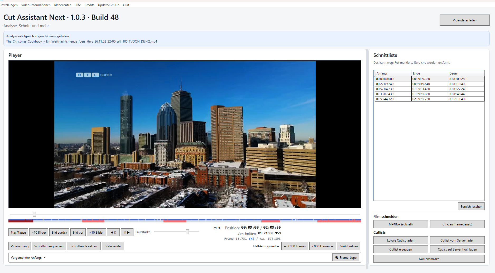

# Freeze – CAN 1.0.3, 03.11.2026

## Auftrag und Identität

Nach der positiven Sichtbestätigung der korrigierten Power-User-2-Ansicht beauftragt der Nutzer ausdrücklich Dokumentationsabgleich, Commit und Push: **„dieser stand wird jetzt eingefroren“**. Der Commit, der diesen Bericht erstmals aufnimmt, bezeichnet den eingefrorenen Quellstand. **Veröffentlichung erst nach gesonderter Freigabe.**

- CAN **1.0.3**, Buildzähler **48**, Dateiversion **1.0.3.48**.
- otr-can **0.1.6**, libmpv **0.41.0**, .NET 10/WPF, Windows 11 x64.
- Kein Versions-/Buildsprung, neuer Paketsatz, Release-Tag oder GitHub-Release in diesem Auftrag. Der bisher dokumentierte öffentliche Stand bleibt **1.0.2 Build 48** mit unveränderten Paketen.
- Nach dem Freeze keine weiteren Produktänderungen ohne neuen Auftrag; spätere Änderungen sind separat auszuweisen. Commit und Push sind keine Veröffentlichungsfreigabe.

## Eingefrorener Funktionsumfang

1. Gemeinsame Server-/Lokal-Cutlist-Tabelle ohne Vorauswahl oder automatische Bevorzugung. Lokale Namensregel: vollständiger Originaldateiname einschließlich Endung plus `.cutlist`, ausschließlich im konfigurierten Cutlist-Verzeichnis und im Filmverzeichnis. Keine Rekursion oder Ähnlichkeitssuche. Bytegleiche lokale Inhalte zusammenfassen, unterschiedliche gleichnamige Treffer getrennt anbieten.
2. Technisch gültige begonnene Cutlists zulassen; keine unbelegte Anzeige „Unfertig“. Aktuelle Arbeit vor Ersetzen schützen, eigene gespeicherte Dateien bei Serverwahl/Ablehnung unverändert lassen, keine automatische Zusammenführung. Bisherige manuelle Ladewege und Überschreibentscheidung erhalten.
3. Einheitliche Dauer **HH:MM:SS.mmm** und eindeutige Spalte **Downloads (reg.)**. Der zweite serverseitige Gesamtzähler wird vom bisherigen Suchabruf nicht geliefert.
4. Dauerhafte Schnittarbeitsweisen **Rot / Das kann weg** und **Grün / Das soll bleiben**, wirksam ab dem nächsten geöffneten Film. Fester offener Anfang und bewegliche transparente Vorschau; gültiges Ende übernimmt, Esc verwirft nur die offene Markierung. Offene Anfänge verhindern das Speichern; vor grüner Ausgabe bewusste Bestätigung der ausschließlich markierten Bereiche.
5. Drei Layouts **Standard / Power-User 1 / Power-User 2**. Dieselben Schnittbuttons und die Suche beim Player, hervorgehobene Vormerkung und größere rechte Tabelle. Rückfall bei Platzmangel und Wiederherstellung der Wunschansicht erhalten den Schnittzustand. **+10 Bilder und beide Keyframe-Buttons liegen auf gleicher Höhe**; Originalmaße der anderen Ansichten werden wiederhergestellt.

Schnittmotoren, Kontrollplayer, Klebecenter und klassisches Cutlist-Dateiformat bleiben gegenüber dem Ausgangsstand dieser Erweiterungen erhalten.

## Abschließende Prüfung

Der unveränderte Produktquellstand wurde für diesen Freeze erneut in einem eigenen Ausgabeordner gebaut und getestet:

| Prüfung | Ergebnis |
| --- | ---: |
| Release-Build | 0 Warnungen, 0 Fehler |
| Core.Tests | 200 |
| Cutlists.Tests | 80 |
| Media.Tests | 390 |
| App.Tests | 1058 |
| Gesamt | **1728 bestanden, 0 Fehler, 0 übersprungen** |

Formatprüfung aller geänderten C#-Dateien ohne Änderungen bestanden; Git-Diff ohne Whitespacefehler. **1382 lokale Dokumentationslinks** geprüft, keine fehlenden Ziele.

Vorhandene native Nachweise: zwölf Power-User-2-Prüffallgruppen mit geladenem synthetischem Film, zwei Tonspuren und WPF-Root-DPI 100/125/150/200 %; zusätzlich gezielte Buttonprüfung mit **0 DIP** Kantenunterschied. Diese Läufe wurden für die anschließende reine Dokumentations-/Git-Sicherung nicht erneut ausgeführt. Keine neue Paket- oder VM-Abnahme daraus abgeleitet.

Lokale Prüfunterlagen: `.build/freeze-1.0.3-20261103/BUILD.binlog`, TRX unter `test-results/` und `SOURCE-MANIFEST.json`; sie werden nicht eingecheckt.

**Quellprüfsumme:** 391 Produkt-/Testdateien (.cs, .csproj, .xaml unter src/tests) sowie vorhandene Version.props, Directory.Build.props, Solution, global.json, NuGet.Config und .editorconfig. UTF-8-Text CRLF zu LF normalisiert; SHA-256 pro Datei; Pfade ordinal sortiert; Verkettung je Zeile: SHA256, zwei Leerzeichen, Pfad, LF. SHA-256 dieser Verkettung:

```text
7f63be451acea9b308d1756fa7e6d112adcf6b6471b433e847b20bab48832870
```

## Persönliche Nachweise

- **NCIS Sydney:** gemeinsame Tabelle, gleiche Dauer und eindeutige Downloadbeschriftung persönlich bestätigt.
- **Chicago Fire:** otr-can, Schnitt, Bild, beide Tonspuren und Drei-Sekunden-Vorschau in der vorausgegangenen lokalen 1.0.3-Prüffassung positiv; kein nachträglicher grüner Filmschnitt daraus abgeleitet.
- **Santa Tell Me:** grüner Modus, vier Behaltebereiche, **01:21:24.120**, MP4Box-/otr-can-Protokolle, gespeicherte Cutlist und Servereintrag; Ton-/Bild-/Schnitt-/Vorschauprüfung positiv.
- **The Christmas Cookbook:** in Power-User 2 otr-can-Schnitt mit **121724 Videopaketen** und **233710080 AAC-Samples**, rechnerisch **01:21:08.960**; Ton, Bild, Schnitt und Drei-Sekunden-Vorschau persönlich positiv. Nach angekündigtem Versionswechsel folgt die positive Sichtaufnahme der korrigierten Buttonreihe: **„Ich glaube das sieht sehr gut aus :-)“**. Die Zuordnung zur Korrekturfassung folgt dem Gespräch; der Screenshot allein enthält keinen Dateipfad oder Binärhash.



Die letzte Aufnahme ist eine Sichtbestätigung, kein zusätzliches Schnittprotokoll der Korrekturfassung. Die dortige Millisekundenanzeige wird nicht zur Änderung bestehender Schnittpunkte oder des nachgewiesenen Motorergebnisses verwendet.

## Erhaltene Grenzen und Arbeitsbaum

- Persönliche Wiederaufnahme einer begonnenen gespeicherten Arbeit bleibt ein eigener offener Praxisfall. Klassische Cutlists speichern abgeschlossene Intervalle, keine vollständige Arbeitsstandsverwaltung oder zuverlässige Fertigstellungsinformation. Offene Markierungen werden nicht verlustbehaftet als gespeichert ausgegeben.
- Physische Monitorwechsel, globale Windows-Skalierung/Hochkontrast sowie neue Setup-/Portable-/VM-Abnahmen sind nicht durch die bisherigen WPF-Prüfungen ersetzt. Bestehende AVI-/MP4Box-/Zeitstempelgrenzen bleiben dokumentiert.
- Vier seit früheren Arbeiten vorhandene lokale Produktions-Lockdateiänderungen werden **unverändert erhalten und nicht in den Freeze-Commit aufgenommen**. Sie entfernen lediglich leere Runtimeabschnitte, ändern keine Paketversionen. Im Repository verbleiben die bisherigen vollständigen Lockdateien. Ein erster gesperrter Restore ohne Runtimebezeichner meldete NU1004 für die Test-Locks; anschließend bestand der gesperrte **win-x64**-Restore mit isolierten Kopien der versionierten Locks. Keine Lockdatei zur Umgehung neu berechnet.
- Geprüft mit direktem `dotnet build ... -p:CanBuildNumber=48`; das regulär zählererhöhende Buildskript wurde für den unveränderten Freeze bewusst nicht ausgeführt. Laufende Benutzerfassung und persönliche Einstellungen wurden nicht verändert.
- Keine realen Filmdateien, lokalen Konfigurationen, Zugangsdaten, Buildausgaben oder Paketarchive im Commit. Frühere datierte Berichte bleiben historische Nachweise; dieser Bericht und die aktuellen Übersichten nennen den abschließenden Stand.

## Weiteres Vorgehen

Quellstand und Dokumentation werden wie beauftragt auf dem vorhandenen Branch `main` gesichert und zu `origin/main` gepusht. Danach ist der Stand eingefroren. Paketierung und Veröffentlichung benötigen einen weiteren Auftrag beziehungsweise die ausdrückliche Freigabe; kein automatischer Veröffentlichungstermin.

[Entwicklungsnotizen](RELEASE-NOTES-1.0.3.md) · [Nutzeranleitung](NUTZERANLEITUNG.md) · [Cutlist-Tabelle](CUTLIST-TABELLE-IMPLEMENTIERUNG-20261103.md) · [Schnittmodi](SCHNITTMODI-TIMELINE-20261103.md) · [Power-User 2](POWER-USER-2-IMPLEMENTIERUNG-20261103.md) · [Christmas-Cookbook-Praxis](CHRISTMAS-COOKBOOK-PRAXISTEST-20261103.md)
