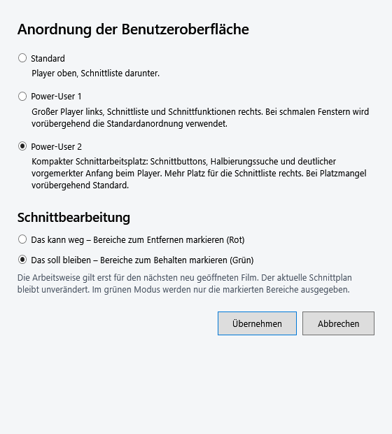
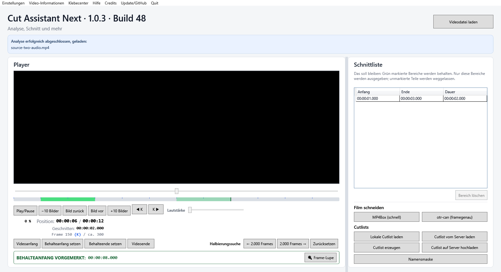
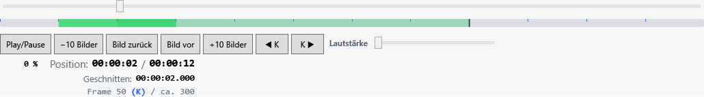

# Power-User 2 – Implementierung und Qualitätssicherung

**Abschließender Stand 03.11.2026:** CAN 1.0.3 / Zähler 48 einschließlich Buttonkorrektur und persönlicher Sichtbestätigung ist auf Nutzerauftrag eingefroren; Commit und Push sind beauftragt, Veröffentlichung erst nach gesonderter Freigabe. Die folgenden Prüf-/Git-Aussagen dokumentieren ihre jeweiligen früheren Arbeitsschritte. [Aktueller Freeze und Nachweise](FREEZE-1.0.3-20261103.md).

Stand: **03.11.2026**, lokaler CAN-1.0.3-Entwicklungsstand, Buildzähler **48**. Umsetzung gemäß ausdrücklicher Entwicklungsfreigabe nach dem [Layoutkonzept](PROFI-ANSICHT-2-KONZEPT-20261103.md).

## Ergebnis und Auswahl

Unter **Einstellungen → Darstellung und Schnittbearbeitung … → Anordnung der Benutzeroberfläche** stehen jetzt genau die drei freigegebenen Namen:

1. **Standard**
2. **Power-User 1** – bisherige Power-User-Anordnung
3. **Power-User 2** – neuer kompakter Schnittarbeitsplatz

Die bisherigen numerischen Werte bleiben **Standard = 0**, **PowerUser = 1**; neu ist **PowerUser2 = 2**. Fehlende/ungültige Einstellungen fallen weiterhin auf Standard zurück. Es gibt keine automatische Aktivierung der neuen Ansicht. Die Auswahl wird in der bisherigen `appearance-settings.json` gespeichert und wirkt nach Übernehmen sofort auf den laufenden Arbeitsplatz. Die unabhängige Schnittarbeitsweise Rot/Grün bleibt gespeichert und gilt weiterhin erst für den nächsten geöffneten Film.

## Tatsächlich implementiertes Layout

Links bleiben derselbe Videohost, Slider und Timeline. Direkt darunter stehen die bisherigen Playeraktionen. Die vier bestehenden Schnittbuttons bilden darunter eine ungeteilte horizontale Reihe: **Videoanfang**, **Schnitt-/Behalteanfang setzen**, **Schnitt-/Behalteende setzen**, **Videoende**. Die tatsächlich gemessene Breite bestimmt, ob die vorhandene Halbierungssuche rechts daneben oder unmittelbar darunter liegt. Keine zweite Suche und keine zweiten Schnittbutton-Instanzen.

Darunter steht die bestehende Vormerkung mit Frame-Lupe. Ein offener Anfang erscheint fett und modeabhängig rot beziehungsweise grün:

- **SCHNITTANFANG VORGEMERKT: 00:00:08.000**
- **BEHALTEANFANG VORGEMERKT: 00:00:08.000**

Die Startzeit bleibt fest, während die vorhandene Timeline-Vorschau dem Slider vorwärts/rückwärts folgt. Ein gültiges Ende und Esc beenden die Hervorhebung, ein ungültiges Ende erhält sie. Ohne offenen Anfang ist die Zeile neutral. Keine Animation oder neue Rückfrage.

Rechts verbleiben Header und Moduserklärung, die größere gemeinsame Schnittpunkttabelle, Bereich löschen und die bisherigen Gruppen Film schneiden, Cutlists und Namensmaske. Auswahl, Sortierung, Grenzbearbeitung und Scrollfunktion der Tabelle bleiben erhalten. In einem nativen Vergleich bei identischer Fenstergröße 1900×1000 DIP stieg die gemessene Tabellenhöhe von **204,827 DIP** in Power-User 1 auf **412,827 DIP** in Power-User 2: **208 DIP mehr**. Das ist ein konkreter Testkontext, keine feste Zusage für jedes Fenster.

### Tatsächliche WPF-Aufnahmen

Die folgenden Aufnahmen stammen von der geöffneten implementierten WPF-Anwendung mit geladenem, synthetisch erzeugtem MP4-Testfilm und zwei AAC-Tonspuren. Sie sind keine Konzeptskizzen. Der native Videobereich erscheint in der WPF-Bitmap schwarz, weil ein `HwndHost` separat zeichnet; geladenes Medium, Playerzustand, Tonspur und unverändertes HWND wurden unabhängig davon nativ geprüft. Es wurde kein Videobild nachträglich in die Aufnahmen eingesetzt.

[Roter Modus mit offenem Anfang](images/power-user2-rot-20261103.png) · [Schmaleres Fenster mit Suche unter der Viererreihe und abgeschlossenen Bereichen](images/power-user2-schmal-20261103.png).

## Dateien und Integrationspunkte

| Datei unter `src/CutAssistantNext.App/` | Umsetzung |
| --- | --- |
| `Settings/AppearanceSettingsStore.cs` | Explizite kompatible Enumwerte 0/1/2; gleicher Speicherweg. |
| `Dialogs/AppearanceSettingsDialog.xaml` / `.xaml.cs` | Sichtbare Namen Standard, Power-User 1, Power-User 2; dritte Auswahl; unabhängige Rot-/Grün-Wahl erhalten. |
| `MainWindow.xaml` | Leerer linker `Power2EditingDock`, Markergrid und Vormerkhosts als Geschwister von `PlaybackControls`; bestehender Video-/Timeline-/Tabellenparent bleibt erhalten. |
| `MainWindow.xaml.cs` | Der neue Dock erhält ausdrücklich den vorhandenen Schnittplan-DataContext. Keine neue Schnittfunktion. |
| `MainWindow.Layout.cs` | Wunschlayout und aktives Layout als drei eindeutige Zustände; gemessener Breitenrückfall, Wiederherstellung, eigene kompakte Höhenuntergrenze. |
| `MainWindow.CutToolsLayout.cs` | Vorhandene Instanzen für drei Zielanordnungen versetzen; ursprüngliche Darstellungswerte und aktiven Content-Bindungen erhalten; ausgeblendete Markerhöhe rechts nicht reservieren. Die bisherige boolesche interne Überladung delegiert für bestehende Tests an die eindeutige Enum-Variante. |
| `MainWindow.PowerUser2.cs` (neu) | Nur die kompakte Darstellung und Vormerkung, Sicherung/Wiederherstellung von Suchplatzierung und Farben; keine Änderung am Schnittplanmodell. |
| `Controls/CutToolStripPanel.cs` (neu) | Kleine WPF-Anordnungskomponente: gemessene Viererreihe zusammenhalten, dieselbe Suchgruppe daneben oder darunter anordnen. Keine Medien- oder Schnittlogik. |

Tests: `Settings/AppearanceSettingsStoreTests.cs` um Wert 2 erweitert und `PowerUser2LayoutTests.cs` ergänzt. **15 zusätzliche Fälle** gegenüber den vorhandenen 1709; keine alten Tests entfernt.

### Erhalt von Bindungen, Events und Zuständen

Die vier Buttons erben links weiter den Schnittplan-Kontext, nicht den Playback-Kontext. Der neue Dock liegt außerhalb des anders aktivierten `PlaybackControls`-Blocks. Die Suche behält ihren eigenen Such-DataContext, die Lupe die bisherigen Window-Bindungen. Alle vorhandenen Clickhandler und Tastaturwege bleiben dieselben; sie werden beim Wechsel nicht zusätzlich abonniert.

Die tatsächlichen Darstellungswerte von Schnitt- und Playerbuttons werden vor dem ersten Wechsel gesichert. Power-User 2 verwendet Auto-Höhe, mindestens 30 DIP, Padding 8/3 DIP und kleine Abstände. Vertikale Zentrierung verhindert, dass kompakte Playerbuttons auf die Höhe des mehrzeiligen Zeitblocks gedehnt werden. Für Standard/Power-User 1 werden die ursprünglichen Höhen, Mindestmaße, Abstände, Ausrichtung und Templates wiederhergestellt. Content-Bindungen für rote/grüne Beschriftungen werden nicht durch gespeicherte Texte ersetzt.

Beim Versetzen der Suche werden Row, Column, RowSpan und ColumnSpan vollständig gesetzt; beim Rückwechsel stehen wieder die ursprüngliche Row 2 und ColumnSpan 8 sowie der ursprüngliche Rand zur Verfügung. Die Tabelle bleibt dieselbe Instanz am selben Parent. Aktive Sortierung und ausgewählte Kante bleiben erhalten und nach dem Wechsel weiter editierbar.

Die Vormerkdarstellung verwendet die vorhandenen `PendingStart`-/Modusmeldungen. `CutPlanViewModel` wurde dafür nicht geändert. Die System-Hintergrundressource wird erst beim tatsächlichen Aktivieren von Power-User 2 angebunden; ein fenstergebundener Hintergrundbeobachter aktualisiert die Farbe und wird beim Schließen entfernt. Ursprüngliche Foreground-Werte werden als lokale WPF-Werte gesichert; geerbte Werte bleiben beim Wiederherstellen geerbt.

## Größen, Farben und DPI

- Beide Power-User-Ansichten behalten den bisherigen Breitenrückfall ab ungefähr 1100 DIP verfügbarer Breite. Für Power-User 2 wird zusätzlich die tatsächlich gemessene gesamte Viererreihe geprüft. Passt sie links nicht, erfolgt Standard, ohne die gewünschte Auswahl zu überschreiben.
- Bei ausreichend Platz kommt Power-User 2 automatisch zurück. Suche und Markerreihe werden nicht durch eine feste zweite Bildschirmgrenze getrennt; ihre Inhaltsbreiten bestimmen den Umbruch.
- Die neue Ansicht verwendet eine kompaktere Mindesthöhe von 560 DIP für das Hauptgrid statt der bisherigen 840-DIP-Untergrenze der alten Power-User-Ansicht. Bei geringer Höhe bleibt der bestehende äußere Bildlauf verfügbar. Im Standard-Rückfall scrollt eine lange Liste gegebenenfalls zusammen mit der Arbeitsfläche; in aktiver Power-User-2-Anordnung scrollt sie in der Tabelle.
- Die tatsächlichen Buttoninhalte bleiben mit Auto-Höhe und Umbruch lesbar. Auch ein großer Test-Schriftgrad löst den Breitenrückfall aus, anstatt die vier Buttons aufzuteilen. Lange Vormerkzeiten bleiben vollständig; die Zeile darf wachsen.
- Heller Hintergrund: dunkles Rot/Grün; dunkler Hintergrund: helles Rot/Grün. Die tatsächliche Hintergrundfarbe steuert die Auswahl. Beide Farben erfüllen in den geprüften Weiß-/Schwarzfällen mindestens 4,5:1 Kontrast. Im Hochkontrastzweig wird die System-Textfarbe verwendet; der Modustext bleibt eindeutig.

### Praktische Skalierungsprüfung

Die WPF-Wurzel-DPI wurde über `VisualTreeHelper.SetRootDpi` tatsächlich auf 100/125/150/200 % gesetzt und zurückgelesen. Zusätzlich wurden entsprechend kleinere logische Fensterinhalte geprüft. Das ist stärker als nur ein verkleinertes PNG, ersetzt aber keine Änderung der globalen Windows-Skalierung oder einen physischen Monitorwechsel.

| WPF-DPI angefordert / zurückgelesen | Angeforderte Fensterbreite | Tatsächliches Layout | Lange Schnittliste |
| --- | ---: | --- | --- |
| 1,00 / 1,00 | 1920 DIP | Power-User 2 | Tabellen-Bildlauf |
| 1,25 / 1,25 | 1536 DIP | Power-User 2 | Tabellen-Bildlauf |
| 1,50 / 1,50 | 1280 DIP | Power-User 2 | Tabellen-Bildlauf |
| 2,00 / 2,00 | 960 DIP | Standard-Rückfall | äußerer Bildlauf |

Die angeforderten Höhen waren jeweils 1080 geteilt durch Skalierungsfaktor; reale Fenster werden zusätzlich durch ihre vorhandene Mindesthöhe begrenzt. Die nutzbare Inhaltsbreite unterscheidet sich wegen Rahmen, Rändern und Scrollbar von der äußeren Fensterbreite. Deshalb ist bei sehr knappen Grenzen ein früherer Standard-Rückfall korrekt. Bei 1900 DIP steht die Suche neben der Markerreihe, im nativen 1280×700-DIP-Fall darunter.

Physische DPI-/Mehrmonitorwechsel und eine echte globale Windows-Hochkontrastumschaltung bleiben zusätzliche persönliche Prüfvarianten. Der Hochkontrast-Farbzweig sowie helle/dunkle Hintergründe wurden automatisiert geprüft; eine vollständige neue Dark-Theme-Oberfläche wurde nicht eingeführt.

## Build und Tests

Abschließender Release-Build: **0 Warnungen, 0 Fehler**. Alle **1724/1724 Tests** bestanden, keine übersprungen:

| Projekt | Bestanden |
| --- | ---: |
| Core.Tests | 200 |
| Cutlists.Tests | 80 |
| Media.Tests | 390 |
| App.Tests | 1054 |
| Gesamt | **1724** |

Neue automatisierte Fälle prüfen den tatsächlichen Einstellungsdialog für alle drei Werte mit unabhängiger grüner Auswahl, sämtliche Layoutkombinationen in beiden Modi, Instanz-/Bindungs-/Geometrieerhalt, reale Schnittbutton-Klicks nach wiederholten Wechseln, Vormerkzustände und Farben, feste Zeit bei Sliderbewegung, ungültiges Ende und Abbruch, große Stundenwerte, Sortierung/Kantenauswahl und Grenzbearbeitung, Suchumbruch, übergroße Markertexte, Rückfall/Wiederkehr sowie vier WPF-DPI-Stufen mit langer Liste und erreichbaren Aktionen.

Die vorhandenen gemeinsamen Cutlist-, Parser-/Frame-/Zeit-, Motor-, Kontrollplayer-, Drei-Sekunden- und Klebecenter-Tests bleiben vollständig erhalten und erfolgreich. Timeline-/Keyframeberechnung wurde nicht verändert; deren vorhandene Vorschau-Leistungsprüfung besteht weiter.

### Zwölf native Prüffallgruppen

Ein separates Prüfprogramm unter `.build/` wurde gegen die endgültigen Produkt-DLLs gebaut und ausgeführt. Es öffnete das echte Hauptfenster, lud einen synthetischen zwölfsekündigen H.264-Testfilm mit zwei AAC-Tonspuren und prüfte:

1. Alle Layoutwege bei pausiertem Player, gleiches HWND, dieselben Controls, gleiche Schnittpunkte/offener Anfang und dieselbe zugeordnete Cutlist-Identität; zuvor ausgewählte **Tonspur 2** blieb erhalten. Tabellenhöhe direkt verglichen.
2. Layoutwechsel während laufender Wiedergabe ohne Unterbrechung oder neues Videofenster.
3. Roter offener Anfang, feste Zeit bei vorwärts/rückwärts Seeking, Timeline-Synchronität, echter Esc-Tastaturweg, ungültiges und gültiges Ende.
4. Dasselbe im grünen Modus.
5. Suche daneben/darunter, schmaler Standard-Rückfall und automatische Wiederherstellung der gewünschten Ansicht.
6. WPF-DPI 100 % mit 40 Schnittbereichen, erreichbaren Buttons und Tabellen-Bildlauf.
7. WPF-DPI 125 % mit denselben Prüfungen.
8. WPF-DPI 150 % mit denselben Prüfungen.
9. WPF-DPI 200 % mit Standard-Rückfall und äußerem Bildlauf.
10. Tatsächliche Halbierungssuche mit Richtungswechsel/Reset und decodierte Frame-Lupenvorschau.
11. Vorhandenen Frame-Lupen-Button betätigt, echten Dialog geöffnet, Bildvorschau abgewartet und Dialog geschlossen.
12. Eine vorhandene kleine AVI-Testdatei geladen: Suche ausgeblendet und Lupe gesperrt in allen drei Layouts. Nach MP4-Wechsel wieder freigegeben, HWND erhalten.

**Keine WPF-Bindungswarnungen oder -fehler** im abschließenden nativen Protokoll. Keine echte Filmdatei in Git aufgenommen. Serversuche für diesen isolierten Medienlauf unterdrückt; kein Upload und kein neuer Filmschnitt oder Klebevorgang gestartet. Der Prüfer verwendet eigene Fensterpräferenzen im Entwicklungsordner; persönliche Einstellungen wurden nicht übernommen oder verändert.

Frühe parallele WPF-Gesamtläufe machten eine Blockade bei zu früher Auflösung der ursprünglichen Textfarbe sichtbar. Einzelfälle bestanden. Die Sicherung wurde auf lokale WPF-Werte umgestellt und die Systemfarben-/Hintergrundanbindung auf den tatsächlich verwendeten neuen Bereich begrenzt. Danach bestehen die vollständigen parallelen Läufe einschließlich der neuen Fälle. Kein Timeout erhöht und kein Test zur Umgehung entfernt.

## Nachweise und Erhaltung

Isolierter Entwicklungsordner: `.build/power-user2-20261103/`. Locked Restore mit den vorhandenen Lockdateien über das schon zuvor eingerichtete Restore-Ziel; Build ausdrücklich mit **CanBuildNumber=48**, ohne das zählererhöhende reguläre Skript. Nur die Dateien dieses Schritts wurden formatiert.

- `BEFORE.json` und `CHANGED-CODE.json`: Ausgangs-/Änderungsnachweis. Sieben vorhandene App-Quelldateien und eine vorhandene Einstellungs-Testdatei geändert; zwei neue App-Dateien und eine neue Testdatei ergänzt.
- `BUILD.binlog`, vollständige TRX unter `test-results/`; WPF-Bilder unter `ui-proof/`.
- `qa/Program.cs`, `proof/PROOF.json`, leeres `proof/BINDINGS.log` und tatsächliche WPF-Aufnahmen unter `proof/`. Die zum nativen Prüfen geladene App-DLL ist SHA-256-/bytegleich zur endgültigen Entwicklungs-App-DLL.
- `RELEASE48-UNCHANGED.json`: alle **sechs** eingefrorenen Programme/Archive von CAN 1.0.2 Build 48 erneut gegen deren vorhandene SHA256SUMS verifiziert: Setup, Portable, CAN-Quellen, otr-can-Quellen und beide libmpv-Quell-/Relinkpakete stimmen überein.

Core-/Media-/Cutlists-Quellen, Schnittmotoren, Cutlist-Dateiformat, gemeinsame Server-/Lokal-Erkennung, Kontrollplayer und Klebecenter blieben gegenüber Beginn dieses Auftrags unverändert. Auch `Version.props` (**1.0.3**), Buildzähler **48** und sämtliche vorbestehenden Produktions-Lockänderungen blieben erhalten. Vorhandene lokale Änderungen wurden weder zurückgesetzt noch überschrieben.

Git enthält die früheren lokalen 1.0.3-Arbeiten und zusätzlich diese freigegebene UI-Erweiterung samt Tests, Bericht und vier WPF-Bildnachweisen. Nichts gestaged, committet, gepusht, paketiert oder veröffentlicht. Die Konzeptunterlagen bleiben mit ihrer damaligen Skizze als Vorstufe erhalten; aktuelle Dokumentation verweist auf diesen Implementierungsstand.

## Bereit zur persönlichen Abnahme

Aktuelle Anwendung: `.build/power-user2-20261103/out/bin/CutAssistantNext.App/release/CutAssistantNext.App.exe` aus dem vollständigen Ordner starten. Unter Darstellung **Power-User 2** auswählen und übernehmen. Ein aktiver Film muss dafür nicht neu geladen werden; die gewählte Schnittarbeitsweise bleibt unverändert.

Persönlich noch zu prüfen sind die neue Bedienanordnung mit eigenen Filmen sowie bei Bedarf echte Windows-/Monitor-DPI- und Hochkontrastwechsel. Die frühere Santa-Tell-Me-Filmabnahme bleibt gültig, wird aber nicht als persönliche Abnahme der erst danach implementierten Ansicht gezählt. Nach diesem Abschluss wird vor Paket-/Release-Arbeit angehalten.

## Nachtrag 03.11.2026 – persönliche Sichtprüfung und Buttonausrichtung

Der Nutzer bestätigt die Anordnung mit geladenem Santa-Tell-Me-Film positiv („Das sieht sehr gut aus :-)“). Mit The Christmas Cookbook ist auch der rote Vormerkzustand persönlich positiv gezeigt: Anfang **00:27:09.240** bleibt fest, während der Player später **00:35:19** und die mitgewachsene Vorschau zeigt. Weitere persönliche Tests laufen; daraus wird keine vollständige neue Filmschnitt- oder Paketabnahme abgeleitet.

Der dabei gemeldete Höhenversatz zwischen **+10 Bilder**, **◀ K** und **K ▶** wurde im WPF-Test bei 100/125/150/200 % mit jeweils **4 DIP** reproduziert. Ursache war der zusätzlich zum Buttonrand bestehende untere Abstand der Keyframe-Gruppe. Nur in Power-User 2 werden deren äußerer Abstand und vertikale Zentrierung angeglichen; die inneren K-Buttons erhalten keinen zusätzlichen unteren Rand. Gruppenmaße werden beim Rückwechsel zu Standard/Power-User 1 wiederhergestellt.

Geändert: ausschließlich `MainWindow.PowerUser2.cs`, vier neue Skalierungsfälle im vorhandenen `PowerUser2LayoutTests.cs` sowie dieser Dokumentationsnachtrag. Vorher-Nachher-TRX liegen getrennt unter `.build/power-user2-alignment-20261103/`. Der gezielte native Test mit geladenem synthetischem Film misst **0 DIP Unterschied** an Ober- und Unterkante.

Neuer Gesamtstand: **1728/1728 Tests**, keine übersprungen (Core 200, Cutlists 80, Media 390, App 1058), Release-Build **0 Warnungen/0 Fehler**. Die bisherigen 1724 Tests und zwölf nativen Gruppen oben bleiben der ursprüngliche Implementierungsabschluss; dieser Nachtrag ergänzt vier automatisierte Fälle und eine gezielte native Ausrichtungsprüfung.

Die Korrektur liegt separat unter `.build/power-user2-alignment-20261103/out/bin/CutAssistantNext.App/release/`. Die vom Nutzer weiter getestete ursprüngliche Power-User-2-App-DLL ist per SHA-256 unverändert, wurde nicht überschrieben und die Anwendung nicht neu gestartet. Version 1.0.3 und Buildzähler 48 ebenfalls unverändert. Kein Commit, Push, Paket oder Release.

## Nachtrag 03.11.2026 – Christmas-Cookbook-Filmschnitt persönlich bestanden

Der Nutzer bestätigt im laufenden Power-User-2-Test **Ton, Bild, Schnitt und Drei-Sekunden-Vorschau** für The Christmas Cookbook mit otr-can 0.1.6. Vier Behaltebereiche, **121724 Videopakete**, **233710080 AAC-Samples** (Stereo/48000 Hz); beide Zahlen entsprechen **01:21:08.960**. Damit liegt nach den Sichtprüfungen auch eine positive persönliche Filmschnittprüfung in dieser Anordnung vor. [Vollständiger Praxisnachweis und Zuordnung](CHRISTMAS-COOKBOOK-PRAXISTEST-20261103.md).

Anschließend kündigt der Nutzer an, CAN zu schließen und in die separate Button-Ausrichtungskorrektur zu wechseln. Das ist noch keine Bestätigung, dass deren Programmstart oder persönliche Prüfung bereits erfolgt ist. Kein Code-/Buildwechsel durch diesen Dokumentationsnachtrag.

## Abschließende persönliche Sichtbestätigung und Freeze

Nach dem angekündigten Versionswechsel zeigt die letzte persönliche Aufnahme den geladenen Christmas-Cookbook-Film mit gleich hohen +10-/Keyframe-Buttons. Der Nutzer bewertet die Darstellung positiv und beauftragt anschließend Freeze, Dokumentationsabgleich, Commit und Push. Die Zuordnung zur Ausrichtungskorrektur folgt dem Gespräch; kein zusätzlicher Schnittlauf in der Korrekturfassung behauptet. [Persönliche Aufnahme und Freeze-Nachweise](FREEZE-1.0.3-20261103.md).
