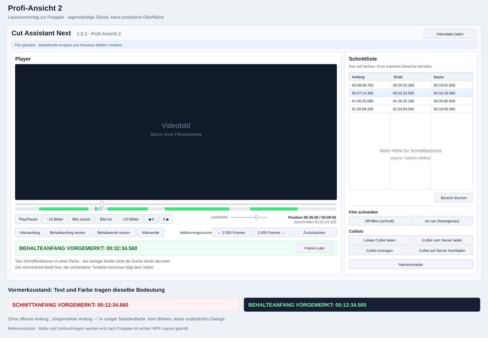

# Profi-Ansicht 2 – Bestandsaufnahme und Layoutkonzept

**Nach ausdrücklicher Freigabe am 03.11.2026 umgesetzt:** Die produktive neue Ansicht heißt verbindlich **Power-User 2**, die bisherige Ansicht **Power-User 1**, daneben **Standard**. [Aktueller Implementierungs- und Prüfbericht mit tatsächlichen WPF-Aufnahmen](POWER-USER-2-IMPLEMENTIERUNG-20261103.md). Das folgende Konzept und seine Skizze bleiben als vorausgegangene Untersuchung erhalten; die damalige Halt-vor-Umsetzung-Anweisung ist durch die gesonderte Entwicklungsfreigabe erfüllt und abgelöst.

Stand: **03.11.2026**, aktueller lokaler CAN-1.0.3-Entwicklungsstand, Buildzähler **48**.

**Status: Vorschlag zur Freigabe. Keine produktive Layoutänderung.**

## 1. Vorschlag auf einen Blick

Eine zusätzliche **Profi-Ansicht 2** erweitert die vorhandene Standard- und Power-User-Ansicht. Der Player bleibt links, die Schnittliste rechts. Vier vorhandene Schnittbuttons wandern als zusammenhängende horizontale Reihe direkt unter die Playersteuerung. Die Halbierungssuche steht auf breiten Fenstern daneben rechts und bei weniger Platz unmittelbar darunter. Eine deutlich farbige Vormerkzeile mit Frame-Lupe folgt unter diesem Bedienbereich.

Rechts entfallen damit die beiden Schnittbuttonzeilen und die bisherige Vormerk-/Lupenzeile. Die Tabelle erhält den gewonnenen Höhenplatz. Darunter bleiben **Bereich löschen**, **Film schneiden**, **Cutlists** und **Namensmaske** in der gewohnten Reihenfolge.

**Zusätzliche Nutzerpräzisierung:** Die neue Ansicht wird ausdrücklich unter **Einstellungen → Darstellung und Schnittbearbeitung …**, Abschnitt **Anordnung der Benutzeroberfläche**, als **dritte Möglichkeit** angeboten. Sie wird nur durch bewusste Auswahl eingeschaltet. Standardansicht und bisherige Power-User-Ansicht behalten ihre bisherige Bedeutung und Speicherung.



Die Skizze ist eine eigenständige Vektorgrafik, keine Aufnahme einer implementierten WPF-Ansicht. Erklärungen in der Skizze dienen der Begutachtung und sind keine beauftragten zusätzlichen Produktmeldungen. Die Flächen und Beispielzeiten legen keine Schnittdaten fest.

## 2. Grundlage und Geltungsbereich

Der Entwicklungsauftrag gibt ausschließlich Untersuchung, Layoutkonzept und gegebenenfalls einen isolierten visuellen Entwurf frei. Die mit Pfeilen versehene Vorlage **img677.pdf** wurde unter dem vom Anwender verwendeten Filmordner gefunden und vollständig visuell geprüft: eine gescannte Seite im A4-Hochformat, mit quer liegender Bildschirmzeichnung. Für die Lesung wurde die gerenderte Seite gedreht; das Original blieb unverändert.

Erkennbar sind die vier eingekreisten Schnittbuttons rechts und deren Verschiebung unter den linken Player. Die ebenfalls eingekreiste Halbierungssuche zeigt einen Pfeil in den unteren rechten Teil des Playerbereichs. Der Vorschlag setzt deshalb Schnittbuttons links und Suche rechts in derselben unteren Bedienzone um. Bei Platzmangel folgt die Suche direkt darunter. Die schriftliche Vorgabe einer durchgängigen horizontalen Viererreihe hat dabei Vorrang vor einer zu engen Ein-Zeilen-Anordnung aller Werkzeuge.

Untersucht wurden die aktuelle README, die früheren Ansichtsberichte und die tatsächlichen XAML-/C#- und Testdateien. Bestehende uncommittete Änderungen der gemeinsamen Cutlist-Tabelle und der Schnittmodi bleiben erhalten. Kein Produktcode, keine Einstellung, kein Schnittmodell, Motor, Klebecenter oder Release-Artefakt wird für dieses Konzept geändert.

## 3. Tatsächlicher WPF-Aufbau

| Baustein | Aktueller Befund | Bedeutung für Profi-Ansicht 2 |
| --- | --- | --- |
| [MainWindow.xaml](../src/CutAssistantNext.App/MainWindow.xaml) | `MainLayoutGrid` mit `PlayerColumn`, `SplitterColumn`, `CutColumn`; derselbe `PlayerSection` und `CutPlanSection` für beide Ansichten. | Dritte Anordnung im bestehenden Fenster; keine zweite Schnittoberfläche. |
| [MainWindow.Layout.cs](../src/CutAssistantNext.App/MainWindow.Layout.cs) | `_preferredLayout` speichert die Auswahl, `_powerLayoutActive` ist bisher nur `bool?`. Power-User wird ab 1100 DIP verfügbarer ScrollViewer-Breite aktiv; sonst Standard. | Ein boolescher Aktivzustand reicht für zwei verschiedene Profi-Anordnungen nicht aus. Gewünschte und tatsächlich verfügbare Ansicht weiterhin getrennt halten. |
| [MainWindow.CutToolsLayout.cs](../src/CutAssistantNext.App/MainWindow.CutToolsLayout.cs) | `ApplyCutToolLayout(bool)` und `MoveCutTool` versetzen dieselben Buttoninstanzen zwischen Standard-Panels und Power-Grids. | Gezielt auf drei Zustände erweitern; Clickhandler, Bindings und Objekte weiterverwenden. |
| Playerbereich | `PlaybackControls` enthält Slider/Timeline, einen Transport-WrapPanel und `PlayerFrameSearchControls` in Zeile 2. Der native `VideoHost` ist ein Geschwisterelement. | Nur zusätzliche WPF-Andockplätze unter der Steuerung; Videohost und Timeline bleiben im bisherigen Elternbaum. |
| Rechter Bereich | `CutContentGrid`: Header Auto, Schnittmarker Auto, Tabelle `*`, Aktionen Auto. `PowerCutMarkersGrid` enthält zwei Buttonzeilen und `PowerPendingGrid`. | In der neuen Ansicht Markerblock rechts ausblenden und die gemeinsame Tabelle auf den freien Platz wachsen lassen. |
| Tabelle | `RemoveSegmentsGrid`, Mindesthöhe 80 DIP, drei Zeitspalten, eigener vertikaler Bildlauf, bestehende Auswahl-/Mausereignisse. | Dieselbe Tabelle mit denselben Spalten und demselben Parent behalten. Keine neue Tabelle oder Grenzbearbeitung. |
| Vormerkung | `PendingStartLabel`, `PendingStartTime`, `FrameLoupeButton`; Zeit aktuell mit 150 DIP reserviert. `PendingStart` und `PendingStartText` werden bereits gemeldet. | Bestehende Elemente in die linke Vormerkzeile versetzen und nur dort modeabhängig hervorheben. Für lange Stundenwerte darf die Zeile wachsen. |
| Rechte Funktionen | `PowerCutEnginesGrid`, `PowerCutlistsGrid`, `PowerNamingGrid`. | Vorhandene Raster und Funktionen kompakter darstellen, keine zusätzlichen Gruppen. |

### Bindungskontexte und geerbte Zustände: entscheidender Integrationspunkt

Im Konstruktor erhalten `PlaybackControls`, `PlayerFrameSearchControls`, `KeyframeButtons`, `CutPlanSection` und `CutTimelineTrack` ausdrücklich unterschiedliche ViewModels. Die vier Schnittbuttons erben derzeit den Schnittplan-Kontext aus `CutPlanSection`; sie haben bestehende **Clickhandler**, keine gesondert neu zu erstellenden Commands.

Würden die Buttons einfach in `PlaybackControls` verschoben, erbten sie dort den **PlaybackViewModel**. Texte wie `StartButtonText` sowie `CanSetStart`/`CanSetEnd` wären falsch angebunden. Außerdem ist der gesamte `PlaybackControls`-Block an `PlayerFrameSearchControls.DataContext.CanInteract` gebunden; dieser geerbte Aktivzustand darf nicht unbemerkt die bisherigen Schnittbuttonregeln verändern.

**Vorschlag:** Ein neuer leerer `Pro2EditingDock` liegt als Geschwister von `PlaybackControls` unterhalb desselben Player-Grids. Seine Schnitt- und Vormerkhosts bekommen ausdrücklich `_cutPlanViewModel` als DataContext. Die ursprünglichen Aktivierungsbindungen bleiben bestehen. Die Suche behält ihren bereits lokal gesetzten `_playerFrameSearch`-Kontext; die Frame-Lupe ihre vorhandenen Window-Bindungen. Kein neuer Player, kein neuer Schnittplan und keine neue Command-Schicht.

## 4. Konkrete Anordnung

### Links: kompakter Schnittarbeitsplatz

| Zeile | Inhalt | Verhalten |
| --- | --- | --- |
| 1 | Vorhandenes Videobild | Derselbe Videohost; nur verfügbarer Platz verändert sich. |
| 2 | Vorhandener Positionsslider und rote/grüne Timeline | Bestehende Werte und dynamische Vorschau unverändert. |
| 3 | Play/Pause, Bildschritte, Keyframes, Lautstärke, Zeit-/Frameanzeigen | Vorhandene Reihenfolge und Tastaturbedienung; kompaktere Abstände nur in Profi-Ansicht 2. Bei Bedarf regulärer Umbruch der Transportanzeige. |
| 4 links | **Videoanfang · Schnitt-/Behalteanfang setzen · Schnitt-/Behalteende setzen · Videoende** | Immer vier zusammenhängende Buttons in einer horizontalen Reihe, wenn die neue Ansicht aktiv ist. |
| 4 rechts | **Halbierungssuche · links/rechts suchen · Zurücksetzen** | Nur bei ausreichender Breite neben der Viererreihe. Sonst als ganze Suchgruppe direkt in die nächste Auto-Zeile; keine Verteilung auf entfernte Bereiche. |
| 5 | **Farbige Vormerkung**, daneben **Frame-Lupe** | Direkt bei den Schnittbuttons; ruhiger Normalzustand, deutliches Rot/Grün bei offenem Anfang. Bei langen Zeiten kann die Zeile höher werden. |

Die Suche wird nicht in die Markergruppe hineinkopiert, sondern als vorhandener `PlayerFrameSearchControls`-Block umgehängt. Ihre AVI-Sichtbarkeit und Suchlogik bleiben erhalten. Die vier Schnittbuttons bleiben auch dann vollständig vorhanden, wenn die AVI-Suchzeile ausgeblendet ist.

### Rechts: mehr Raum für die Tabelle

1. **Schnittliste** und die vorhandene kurze Moduserklärung bleiben oben.
2. Die vorhandene Tabelle füllt die restliche Höhe zwischen Header und Aktionen. Längere Listen scrollen innerhalb der Tabelle.
3. **Bereich löschen** bleibt direkt unter der Tabelle rechtsbündig, ohne Auswahl deaktiviert.
4. **Film schneiden:** zwei gleich breite vorhandene Motorbuttons in einer Zeile.
5. **Cutlists:** zwei Spalten, zwei Zeilen; lokale Auswahl / gemeinsame Suche sowie Erzeugen / Upload. Vollständige Beschriftungen bleiben lesbar.
6. **Namensmaske:** vorhandener Button über die Gruppenbreite.

Die bisherige rechte Mindestbreite **430 DIP** bleibt als konservativer Startwert erhalten. Platz wird vor allem vertikal gewonnen. Die entfallenden beiden 36-DIP-Schnittbuttonzeilen, Abstände und Vormerk-/Lupenzeile ergeben aus dem derzeitigen Raster ungefähr **100–130 DIP** zusätzliche Tabellenhöhe. Das ist eine Abschätzung aus dem bestehenden Aufbau, keine gemessene neue WPF-Geometrie. Kompaktere untere Gruppen können weiteren Platz gewinnen.

## 5. Kompakte Maße ohne Abschneiden

Alle Werte sind **Startwerte für die spätere WPF-Prüfung**, keine festen Pixelvorgaben.

| Eigenschaft | Vorschlag für Profi-Ansicht 2 |
| --- | --- |
| Buttonhöhe | `Height=Auto`, `MinHeight=30 DIP`; bei mehrzeiligem Inhalt wachsen lassen. |
| Innenabstand | Etwa 8 DIP horizontal, 3 DIP vertikal. |
| Abstand in Reihen / zwischen Zeilen | 4 DIP; zwischen Funktionsgruppen etwa 8 DIP. |
| Schriften | Vorhandene lesbare Schriftgröße erhalten; keine pauschale Verkleinerung zum Erzwingen der Breite. |
| Vier Schnittbuttons | Auto-Spalten; Videoanfang/-ende als gleich breites Paar, Anfang-/Ende-setzen als zweites Paar. Lokale SharedSizeGroups statt vier unnötig großer identischer Mindestbreiten. |
| Rechte Buttons | Zwei `*`-Spalten, Texte bei Bedarf umbrechen; keine Ellipse als Ersatz für eine lesbare Aktion. |
| Farbige Vormerkzeile | Fett, etwa 14–16 DIP; `Height=Auto`, nicht auf eine einzige Zeile begrenzen. |

Im vorhandenen XAML stehen `Height`, `Padding` und `Margin` teilweise als lokale Werte. Ein bloß zusätzlich zugewiesener Style würde diese Werte nicht automatisch verdrängen. Deshalb muss die Umsetzung die lokalen Darstellungswerte kontrolliert sichern, nur für Profi-Ansicht 2 übersteuern und beim Verlassen exakt zurückgeben. Die bestehende Sicherung in `CutToolAppearance` lässt sich begrenzt erweitern; für die bisherigen Player-/Suchbuttons ist eine gesonderte Sicherung sinnvoll, damit die alte Power-User-Ansicht nicht versehentlich die neuen Maße erbt.

Die bereits vorhandene Besonderheit bleibt verbindlich: Eine aktive Content-Bindung der Schnittbuttons darf beim Rückwechsel nicht durch einen gespeicherten Textwert ersetzt werden. Sonst gingen „Behalteanfang setzen“ und „Behalteende setzen“ verloren.

## 6. Vorgemerkten Anfang sichtbar machen

| Zustand | Text / Gestaltung |
| --- | --- |
| Kein offener Anfang | **Vorgemerkter Anfang: –**, normale Schrift und ruhige Standardfarbe. |
| Remove / Rot | **SCHNITTANFANG VORGEMERKT: 00:12:34.560**, fett und rot. |
| Keep / Grün | **BEHALTEANFANG VORGEMERKT: 00:12:34.560**, fett und grün. |
| Slider oder Frame-Navigation | Die Vormerkzeit bleibt an `PendingStart` gebunden; ausschließlich die bestehende Timeline-Vorschau folgt der aktuellen Position. |
| Gültiges Ende / Esc | `PendingStart` wird leer; Text und Hervorhebung kehren sofort zum Normalzustand zurück. |
| Ungültiges Ende | `PendingStart` bleibt erhalten; die Hervorhebung bleibt sichtbar. Keine zusätzliche Fehlermeldung oder neue Validierungsregel. |

Für die Darstellung genügen neue read-only Anzeigeeigenschaften, beispielsweise `HasPendingStart` und eine modeabhängige Beschriftung, oder entsprechende XAML-Trigger. Bei zusätzlichen Eigenschaften muss der vorhandene `PendingStart`-Setter ihre Änderungen melden; bei `Initialize` auch die modeabhängige Beschriftung. Zeitberechnung und Lebenszyklus der offenen Markierung bleiben unverändert. Ein neuer vorläufiger Schnittzustand ist nicht erforderlich.

Bei Platzmangel dürfen Beschriftung und vollständige Zeit auf zwei Zeilen stehen. Die Zeit bleibt ein zusammenhängender, nicht abgeschnittener Text; auch große Stundenwerte wie im vorhandenen Maximalzeittest bleiben vollständig. Die Frame-Lupe steht rechts daneben beziehungsweise in einer folgenden Auto-Zeile, wenn deren Mindestbreite sonst nicht passt.

Farbliche Startwerte: auf hellem Hintergrund dunkles Rot **#B91C1C** beziehungsweise Grün **#166534**, auf dunklem Hintergrund helles Rot **#FCA5A5** beziehungsweise Grün **#86EFAC**. Entscheidend ist der tatsächliche Hintergrund, nicht allein der Windows-Modus. Das derzeitige XAML enthält explizit weiße Flächen; eine globale Dark-Theme-Unterstützung wird durch dieses Konzept nicht behauptet oder als Nebenaufgabe eingeführt. Für die lokale Vormerkdarstellung sind Systemressourcen und eine kontrastgerechte Farbwahl zu prüfen; im Hochkontrastmodus Systemfarben und den eindeutigen Modustext verwenden.

Die Hervorhebung gilt in diesem Vorschlag zunächst **nur für Profi-Ansicht 2**. Die beiden vorhandenen Ansichten behalten ihre bisherige Darstellung. Kein Blinken, keine Animation und kein neues Popup.

## 7. Dritte dauerhafte Auswahl und sichere Layoutwechsel

Im bestehenden Einstellungsdialog:

```text
Anordnung der Benutzeroberfläche
  ○ Standardansicht
  ○ Power-User-Ansicht
  ● Profi-Ansicht 2 – kompakter Schnittarbeitsplatz
```

`InterfaceLayout` wird um einen expliziten dritten Wert ergänzt: **Standard = 0, PowerUser = 1, PowerUser2 = 2**. Die vorhandenen JSON-Werte 0 und 1 behalten ihre Bedeutung. Fehlende/ungültige Einstellungen fallen wie bisher auf Standard zurück. Eine neue Radiobutton-Auswahl nutzt dieselbe Gruppe und denselben Speicherweg. Die unabhängige Rot-/Grün-Einstellung bleibt erhalten und gilt weiterhin erst für den nächsten Film. Ein Layoutwechsel gilt weiterhin sofort für den laufenden Film.

Der effektive Layoutzustand in `MainWindow.Layout` muss die drei Anordnungen unterscheiden. Nur den bisherigen booleschen Wert „power“ auf true zu setzen wäre fehlerhaft: Beim Wechsel Power-User → Profi-Ansicht 2 würde sonst kein neuer Umordnungslauf stattfinden. Auch `ApplyCutToolLayout` benötigt einen eindeutigen Layoutparameter statt des bisherigen booleschen Zustands.

Jeder Wechsel setzt Sichtbarkeiten und Zielparents der betroffenen vorhandenen Elemente vollständig für die Zielansicht. Er löst weder `Initialize`, `Reset`, `LoadCutPlan` noch eine Medien- oder Cutlistsuche aus. `VideoHost`, Timeline und Tabelle bleiben am bisherigen Parent. Keine weiteren Clickhandler abonnieren, keine Controls neu erzeugen und kein neues `InitializeComponent`.

Beim Versetzen der Suche sind neben Parent und Margin auch **Grid.Row und Grid.ColumnSpan** zu beachten: Aktuell steht sie in Row 2 mit ColumnSpan 8. `MoveCutTool` setzt bisher nur Row und Column zurück. Für den neuen Host und den Rückwechsel müssen die vollständigen benötigten Attached Properties kontrolliert gesetzt beziehungsweise wiederhergestellt werden. Die bestehende Window-Namensauflösung und ElementName-Bindungen bleiben im selben Namescope erhalten.

## 8. Fensterbreite, Höhe und DPI

- Die gespeicherte Wunschansicht bleibt erhalten. Bei weniger als den bisherigen **1100 DIP** verfügbarer Breite fällt auch Profi-Ansicht 2 zunächst auf Standard zurück und kehrt bei ausreichender Breite zurück. Zusätzlich muss die gemessene Mindestbreite der gesamten Viererreihe in den linken Bereich passen; andernfalls Standard statt Abschneiden oder Aufteilen der vier Funktionen.
- Die Halbierungssuche steht nur dann neben der Viererreihe, wenn beide gemessenen Gruppen einschließlich Abstand passen. Andernfalls unterhalb, im selben linken Bedienbereich. Keine starre zusätzliche Bildschirm-Pixelgrenze.
- Bei geringer Höhe zuerst die Tabelle bis zu ihrer bisherigen Mindesthöhe verkleinern, dann den vorhandenen Bildlauf verwenden. Keine Aktionsgruppe verdecken. Die neue linke Dockhöhe muss im verbleibenden Videoplatz berücksichtigt werden.
- Der aktuelle Power-User-Code erzwingt im Hauptgrid mindestens **840 DIP Höhe**. Dies darf für Profi-Ansicht 2 nicht ungeprüft übernommen werden: dort ist eine aus den sichtbaren Mindestgrößen abgeleitete Höhe vorzusehen. Das bisherige Verhalten von Standard/Power-User bleibt erhalten.
- `UpdateCutToolContentHeight` muss die in der effektiven Ansicht tatsächlich sichtbaren festen Zeilen berücksichtigen. In Profi-Ansicht 2 darf der ausgeblendete rechte Markerblock keinen zusätzlichen Höhenbedarf reservieren.
- 1920×1080 physische Pixel entsprechen bei 125 % ungefähr 1536×864 DIP und bei 150 % 1280×720 DIP, jeweils vor Abzug von Fensterrahmen und Systemleisten. Bei 200 % bleiben ungefähr 960×540 DIP: hier ist Standard als Rückfall plausibel. Diese Umrechnungen ersetzen keine DPI-Prüfung.
- DPI-/Monitorwechsel, Textskalierung und tatsächliche DesiredSize-Messungen müssen später geprüft werden. Umordnen nur bei geändertem effektiven Layout oder geändertem Platzbedarf, nicht bei jedem Playerpositionsereignis.

## 9. Geplanter begrenzter Änderungsumfang nach Freigabe

| Datei | Benötigte spätere Änderung |
| --- | --- |
| `MainWindow.xaml` | Leere linke Andockhosts, Auto-Zeilen, scoped kompakte Darstellung und Vormerk-Trigger; vorhandene rechte Raster weiterverwenden. Transportpanel bei Bedarf benennen. |
| `MainWindow.Layout.cs` | Wunsch-/Effektivzustand für drei Layouts, Breitenrückfall und nur für Profi-Ansicht 2 angepasste Höhenregel. |
| `MainWindow.CutToolsLayout.cs` | Vorhandene Instanzen zwischen drei Zielanordnungen versetzen; Darstellungs-/Suchplatzierungswerte sichern und vollständig wiederherstellen; sichtbare Fixhöhen berücksichtigen. |
| `MainWindow.xaml.cs` | Ausdrückliche DataContexts der neuen Schnitt-/Vormerkhosts einmalig setzen; vorhandene Ereignisse bleiben unverändert. |
| `Settings/AppearanceSettingsStore.cs` | Dritten Enumwert ergänzen, bisherige numerische Werte erhalten. |
| `Dialogs/AppearanceSettingsDialog.xaml` und `.xaml.cs` | Dritte Layoutoption samt Kurzbeschreibung und bestehendem Speicherweg. |
| `ViewModels/CutPlanViewModel.cs` | Falls für klare Bindungen erforderlich, ausschließlich read-only Vormerk-Anzeigeeigenschaften und deren Änderungsmeldungen ergänzen. Keine Schnittberechnung ändern. |
| Vorhandene App-Tests | Dreifachwechsel, Persistenz, Grenzen und native Zustandswahrung ergänzen; bestehende Fälle erhalten. |

Keine Änderung an `CutTimelineTrack`-Vorschauberechnung, Schnitt-/Cutlistmodellen, Server-/Lokal-Import, Schnittmotoren, Kontrollplayer, Tonspurwechsel oder Klebecenter vorgesehen. Keine neue Produktionsabhängigkeit.

## 10. Vorgesehene Prüfungen nach Freigabe

Die folgenden Fälle sind **geplant, noch keine Testergebnisse der neuen Ansicht**:

1. JSON 0/1 bleibt kompatibel, 2 wird dauerhaft gespeichert; fehlende/ungültige Werte bleiben Standard. Auswahl im tatsächlichen Einstellungsdialog, Abbrechen und erneuter Appstart.
2. Alle direkten und wiederholten Wechsel zwischen drei Ansichten; zusätzlich schmaler Rückfall und Wiederkehr. Layoutwechsel bei laufender und pausierter Wiedergabe, offener Markierung und ausgewählter Kante.
3. Identität derselben vier Buttons, Frame-Lupe, Suche, Tabelle und Videohost vor/nach jedem Wechsel; gleiche HWND/Medienidentität, Position, Lautstärke, Tonspur und Play/Pause. Keine neue Suche, kein Planreset, keine geänderte Cutlist-Quelle.
4. Rote/grüne Beschriftungen, `CanSetStart`/`CanSetEnd`, echte Clickhandler und Eventanzahl nach wiederholtem Umhängen. Keine WPF-Bindungsfehler; Such-/Player-/Schnittkontexte richtig getrennt.
5. Feste Vormerkzeit beim Slider-/Framewechsel, kräftige Darstellung nur bei offenem Anfang, gültiges Ende, Esc und ungültiges Ende. Lange Stundenwerte, beide Farben auf hell/dunkel und Hochkontrast.
6. Suche unverändert: Halbierungsfolge, Richtungswechsel, Reset und Abbruch; bei AVI ausgeblendet. MP4-/AVI-Wechsel in allen Ansichten ohne verdeckte oder doppelte Controls.
7. Leere, kurze und lange Schnittliste mit mindestens 40 Bereichen; Tabellen-Bildlauf, Auswahl, Grenzbearbeitung, Löschen, Linksklick/Rechtsklick und Frame-Lupe. Vollständige Zeitwerte ohne Clip.
8. Rechte Gruppen mit langen Beschriftungen; Motor-, Cutlist- und Namensmaskendialoge über dieselben vorhandenen Aktionen öffnen und abbrechen. Kein Upload oder Realfilmschnitt allein für eine Layoutprüfung.
9. Tatsächliche Fenstergrößen, beispielsweise 1920×1080, 1536×864, 1280×720 und 1100×700 DIP, außerdem darunter; 100/125/150/200 % DPI und Monitorwechsel. Logisch kleinere Renderbilder ausdrücklich von echten DPI-Tests unterscheiden.
10. Unterbrechungsfreies Umordnen, keine neue statische Timeline-/Keyframeberechnung pro Sliderbewegung; bestehende gemeinsame Cutlist- und Motor-/Kontrollplayer-Regressionen vollständig ausführen.

Die vorhandenen [CutToolLayoutTests](../tests/CutAssistantNext.App.Tests/CutToolLayoutTests.cs) sichern bereits Instanzidentität, Rückwechsel, Bindungen, tatsächliche Klicks, große Stundenwerte und grüne Beschriftungen. Die [AppearanceSettingsStoreTests](../tests/CutAssistantNext.App.Tests/Settings/AppearanceSettingsStoreTests.cs) decken bisher 0/1 und ungültige Werte ab. Darauf kann die neue Prüfung aufbauen; die bestehende Suite ersetzt keine native Prüfung der dritten Anordnung.

## 11. Ergebnis dieser Analyse und Halt vor Umsetzung

Die dritte Ansicht ist mit begrenzten Erweiterungen der bestehenden Layoutverwaltung plausibel integrierbar. Die maßgeblichen Risiken liegen im geerbten DataContext/Aktivzustand beim Umhängen, den bisher booleschen Layout-Caches, dem Rücksetzen lokaler Darstellungswerte und der Höhenberechnung. Sie erfordern keine Änderung der eigentlichen Schnittfunktionalität.

In dieser Phase neu erstellt: **dieses Konzept** und **die isolierte SVG-Skizze**. Die Dokumentationsübersicht erhält lediglich einen Link, ausdrücklich als Konzept gekennzeichnet. Produktcode, Tests, Einstellungen, Version und Buildzähler bleiben unverändert; es gibt keinen neuen ausführbaren Profi-2-Build und keine tatsächliche DPI-/WPF-Abnahme dieser Ansicht.

Der unveränderte Ausgangsstand wurde erneut geprüft: Release-Build **0 Warnungen / 0 Fehler**, **1709/1709 Tests** bestanden, keine übersprungen (Core 200, Cutlists 80, Media 390, App 1039). Diese Ergebnisse gelten für die vorhandene Anwendung, nicht als Abnahme der vorgeschlagenen neuen Ansicht. Gebaut wurde mit den bestehenden isolierten Ausgaben und ausdrücklich `CanBuildNumber=48`; das zählererhöhende reguläre Buildskript wurde nicht verwendet.

SHA-256-Vergleich: **396 Quell-/Test-/Versionsdateien einschließlich Buildzähler unverändert** gegenüber Analysebeginn. Auch das Original-PDF blieb unverändert. Die 58 lokalen Verweise in Konzept und Dokumentationsübersicht haben vorhandene Ziele; `git diff --check` ohne Fehler. Skizze als PNG gerendert und visuell geprüft. Lokale Nachweise unter `.build/profi-view2-concept-20261103/`: `CODE-BEFORE.json`, `SOURCE.json`, `CHECK.json`, `BASELINE-BUILD.binlog`, `baseline-test-results/` und die PNG-Vorschau. Kein Commit, Push, Versions-/Buildwechsel, Paketbau oder Release.

**Hier anhalten. Die produktive Umsetzung benötigt die im Entwicklungsauftrag vorgesehene Freigabe des Vorschlags.**
