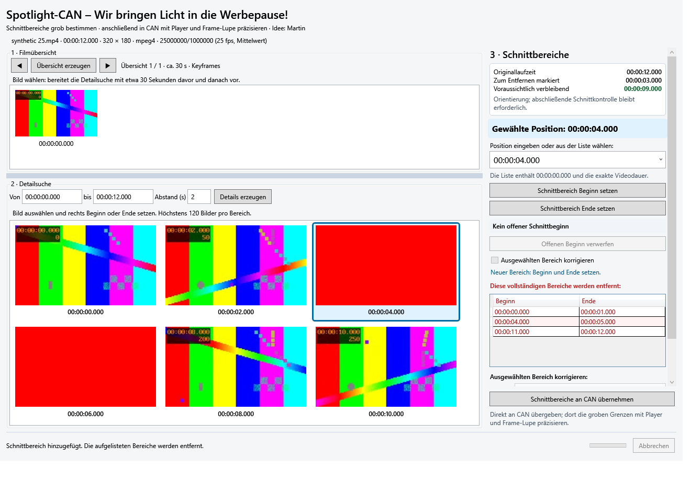

# Spotlight-CAN in CAN – Entwicklungsstand vom 04.11.2026

**Paketprüfung 08.11.2026 abgeschlossen:** Quellcommit `185e8b3`, Setup/Portable/Quellen lokal geprüft und Quellstand gepusht. Build 50 unverändert; persönliche Setup-Prüfung auf dem Arbeitsrechner positiv, VM-Setup mit MP4Box und Spotlight ebenfalls positiv; Portable, otr-can-VM-Test und Deinstallation weiter nicht bestätigt, keine Veröffentlichung. [Ergebnisse, Paketpfad und SHA-256](RELEASE-1.0.3-SPOTLIGHT-BUILD50-RESULT.md).

## Nachtrag 08.11.2026 – Fensterkomfort und Paketvorbereitung

Aktueller Spotlight-Kandidat **CAN 1.0.3 Build 50**, `codex/spotlight-integration`. Die integrierte Werbesuche ergänzt nun dauerhafte Fenstergröße, Position und Maximierung mit Mehrmonitor-/DPI-Korrektur. Persönlich am 07.11.2026 positiv bestätigt. Die nachfolgenden Build-49-Zahlen und Testpfade beschreiben die ursprüngliche Integration; aktuell **1773 CAN- und 78 Spotlight-Tests** sowie 32 native Integrationsfälle und vier Fensterprozesse bestanden. Erneute Paketprüfung separat. [Fensterdetails](SPOTLIGHT-FENSTERZUSTAND-20261107.md), [Build-50-Paketverfahren](PAKETVORBEREITUNG-SPOTLIGHT-BUILD50-20261108.md).

Quellpakete enthalten die fest eingebundene Spotlight-Unterkomponente vollständig. Herkunft und derzeit fehlende eigene Spotlight-Lizenzdatei sind [hier dokumentiert](SPOTLIGHT-QUELLEN.md). Commit und Push des geprüften Zweigs sind jetzt beauftragt; keine Veröffentlichung, kein Merge und keine Audio-Build-51-Übernahme.

## Freigabe und Grenzen

Die persönliche Prüfung der eigenständigen visuellen Werbesuche ist vom Nutzer positiv bestätigt; die Integration ist ausdrücklich freigegeben. Zusätzlich beauftragt: dynamische Anzeige von Original-, Entfernen- und verbleibender Laufzeit in beiden Hosts. Keine Veröffentlichung oder Änderung des stabilen Release-Stands. Entwicklung im getrennten Checkout auf **codex/spotlight-integration**, Ausgangscommit **22f4042**. Vorhandene Dokumentations- und Lockdateiänderungen im ursprünglichen CAN-main bleiben unangetastet.

## Bedienung

[Kurze Spotlight-README](SPOTLIGHT-README.md), insbesondere der Schritt **letzten betroffenen Bereich in CAN mit Videoende abschließen**: Die Detailsuche zeigt standardmäßig Bilder im Zwei-Sekunden-Abstand, keine lückenlose Filmfolge. Der Abstand ist änderbar. Ein letztes Rasterbild muss nicht das tatsächliche Dateiende treffen; die genaue Grenze anschließend im CAN-Schnittfenster setzen. Die vorhandene Positionsliste bietet exakte Zeitgrenzen zusätzlich an.

1. Film wie gewohnt ausschließlich in CAN öffnen. Vorhandene FFmpeg-/ffprobe-Einstellungen und der normale CAN-Standardordner bleiben maßgeblich.
2. **Werkzeuge → Spotlight-CAN – Visuelle Werbesuche** öffnen. Ohne analysierten Film erscheint ein verständlicher Hinweis. CANs bestehende Werkzeugprüfung meldet fehlende oder unbrauchbare Werkzeuge unter Verweis auf Einstellungen → FFmpeg-Werkzeuge.
3. Übersicht und Details erzeugen. Die bisherige getestete Bedienung mit verstellbarem Trenner, auswählbaren Zeitpositionen und exakten Filmgrenzen bleibt erhalten.
4. Entfernen-Bereiche mit **Schnittbereich Beginn setzen / Ende setzen** festlegen. Vorhandenen Spotlight-Bereich auswählen und über die gemeinsamen Schaltflächen einen Korrekturentwurf vorbereiten; erst Korrektur übernehmen speichert ihn.
5. **Schnittbereiche an CAN übernehmen** übergibt den vollständigen validierten Plan. Vor Ersetzen bestehender CAN-Schnitte, offener Anfänge oder vorhandener Cutlist-Metadaten wird ausdrücklich gefragt, Standardantwort Nein. Ablehnen ändert keine der Schnittlisten. Nach erfolgreicher Übernahme schließt Spotlight mit Ressourcenbereinigung.
6. In CAN die Grenzen mit vorhandenem Player, Schnittwerkzeugen und Frame-Lupe präzisieren; CAN-Cutlist wie gewohnt speichern. Im grünen Modus zeigt CAN die dazu komplementären Behaltebereiche; die übergebenen Daten bleiben kanonische RemoveSegment-Bereiche.

Im integrierten Fenster fehlen Filmwahl, FFmpeg-/ffprobe-Felder und eigene Verzeichnisauswahl. Der Cutlist-Speicherknopf wird durch direkte Übernahme ersetzt. Es gibt keine Zwischen-Cutlist, keinen zweiten Player und keinen separaten Spotlight-Prozess. Der gewonnene Platz steht den Vorschaubildern zur Verfügung. Zum Filmwechsel erst Spotlight schließen; das modale Werkzeug und eine zusätzliche Medien-/Generationsprüfung schützen vor einer falschen Zuordnung. Sonstige Werkzeugeinstellungen werden nicht in Spotlight dupliziert.

## Dynamische Laufzeitanzeige

Rechts unter Schnittbereiche stehen **Originallaufzeit**, **zum Entfernen markiert** und **voraussichtlich verbleibend**, jeweils HH:MM:SS.mmm. Verbleibend = Original minus Vereinigungsdauer der abgeschlossenen Entfernen-Bereiche. Hinzufügen, bestätigte Korrektur und Löschen aktualisieren sofort. Offene Anfänge und nicht bestätigte Korrekturentwürfe ändern die Anzeige nicht. Der separate Berechnungshelfer zählt Überschneidungen und Duplikate nur einmal. Orientierungshilfe; abschließende Schnittkontrolle bleibt notwendig.

## Wiederverwendung und Sicherheit

Die gemeinsame Bibliothek **SpotlightCan.Wpf** enthält Fenster und Bedienlogik; Core und Media bleiben UI-unabhängig. CAN bindet den privaten Spotlight-Quellstand **6973b37** über **external/spotlight-can** als Git-Unterkomponente ein. Die eigenständige SpotlightCan.App referenziert dieselben Projekte und behält Filmwahl, Werkzeugfelder und Cutlist-Export. Keine manuell auseinanderlaufende Zweitimplementierung und keine neue NuGet-Produktionsbibliothek.

Für einen neuen vollständigen Quellcheckout sind Anmeldung/Zugriff auf das private Spotlight-Repository und git submodule update --init --recursive erforderlich. Keine Zugangsdaten im Repository. Ein zukünftiges öffentliches Quellen-/Releasepaket muss diesen Quellanteil ausdrücklich berücksichtigen; es wurde hier keines veröffentlicht. Die lokale Prüfversion enthält bereits alle benötigten Spotlight-DLLs und braucht zur Laufzeit keinen Repositoryzugriff.

**SpotlightMediaSession** übernimmt die bestehende MediaAnalysisResult und verwendet dieselbe Dateipfad-/Analyseidentität plus Mediengeneration. Keine zweite ffprobe-Medienanalyse; vorhandene Index-, Größen-, Dauer- und Bildratendaten werden adaptiert. Die vorhandene FfmpegToolChecker-Versionsprüfung wird wiederverwendet. Während der Sitzung hält eine lesende Dateisperre andere Leser offen, verhindert aber Änderung/Löschung des Quellfilms. Schließen/Abbruch gibt eigene Prozesse, Tempbilder und Dateiressourcen frei; ein bereits geschlossenes Fenster wird nicht erneut geschlossen.

Die Übergabe baut zuerst einen unabhängigen gültigen CAN-CutPlan mit RemoveSegment auf. Sortierung, Grenzen und Überschneidungen werden vor Änderungen geprüft. Nach einer Bestätigung werden Medien- und Editorzustand erneut geprüft; unerwartete zwischenzeitliche Änderungen verhindern die Übernahme. Erst danach lädt die bestehende CutPlanViewModel.LoadCutPlan-Logik den vollständigen Ersatz und aktualisiert dieselbe Kollektion für Tabelle/Timeline. Veraltete Cutlist-Upload-/Motor-Metadaten werden erst nach Erfolg ungültig, Namensarbeit bleibt erhalten. Keine neuen Änderungen an Schnittmotoren, Player, Frame-Lupe oder klassischem Cutlist-Format.

Martins ursprüngliche Cutfinder-Idee und AutoIt-Implementierung werden weiterhin gewürdigt. Originaldateien nicht verändert oder übernommen.

## Prüfungen

| Prüfung | Ergebnis |
| --- | --- |
| CAN-Release-Build einschließlich aller gemeinsamen Projekte | **0 Warnungen / 0 Fehler** |
| Bestehende CAN-Tests | **1728 bestanden** |
| Neue CAN-Integrationstests | **16 bestanden** |
| CAN gesamt | **1744 bestanden, 0 Fehler, 0 übersprungen** |
| Gemeinsame Spotlight-/Standalone-Tests | **78 bestanden, 0 Fehler, 0 übersprungen** |
| Eigenständige synthetische Video-/WPF-Prüfung | **48 bestanden**, Exitcode 0 |
| Echte CAN-/Spotlight-Fenster mit libmpv und FFmpeg | **32 Prüfungen bestanden**, Exitcode 0 |
| Gesperrter Windows-x64-Restore | erfolgreich; keine Paketversionen ersetzt |

Die 32 nativen Fälle wurden zusätzlich gegen die fertigen DLLs der bereitgestellten CAN-Prüfkopie wiederholt, ebenfalls vollständig erfolgreich.

CAN: Core 200, Cutlists 80, Media 390, App 1074. Spotlight: Core/Media 59, Bedienung/Host 19. Die 16 neuen CAN-Fälle prüfen Medienübernahme und Lesesperre, ungültigen/fehlenden Film, rote/grüne Darstellung, mehrere Randbereiche, atomaren Ersatz und Ablehnung, ungültige/überlappende Bereiche, veränderten Medienkontext vor/nach Bestätigung, erneute Editoränderungen, Metadatenschutz, bestehende manuelle Korrektur und CAN-Cutlist-Rundlauf sowie konfigurierte Werkzeugpfade. Laufzeitberechnung zusätzlich mit leeren Plänen, unsortierten Überschneidungen/Duplikaten, Rand- und Millisekundenwerten, unvollständigen/ungültigen Bereichen, kompletter Entfernung und dynamischer Aktualisierung getestet.

Die native Prüfrunde startet das tatsächliche CAN-Fenster zunächst ohne Film, lädt einen eigenen synthetischen zwölfsekündigen MP4-Film mit dem vorhandenen libmpv-Player, öffnet das integrierte Spotlight-Fenster in beiden Modi, erzeugt echte Bilder und überträgt 0–1, 4–5 und 11–12 Sekunden. Anzeige: Original 12 s, entfernt 3 s, verbleibend 9 s. CANs bestehende Korrektur verändert anschließend eine Grenze um 40 ms; die CAN-Dateischreib-/Lesefunktionen erhalten den Plan beim Cutlist-Rundlauf. Erneutes Öffnen, abgelehnte/bestätigte Ersetzung, Abbruch und Freigabe der Quelldatei geprüft. Die Werkzeugwerte werden in der nativen Prüfung als isoliertes CAN-Einstellungsobjekt vorgegeben; der reguläre Menüaufruf lädt sie aus FfmpegSettingsStore. Fensterpersistenz des Prüfprogramms ist in den Ausgabeordner umgeleitet; keine Anwenderkonfiguration geschrieben. Bestätigungsentscheidungen werden in der automatisierten nativen Runde über den internen Callback gesetzt; die echte Rückfrage bleibt persönlich zu prüfen.

Die erste vollständige Testrunde zeigte parallele Zeitüberschreitungen bestehender WPF-Gruppen; dieselbe Dialoggruppe bestand isoliert. Die betroffenen STA-UI-Gruppen laufen jetzt in einer nicht parallelen WPF-Collection, da Theme-/Ressourceninitialisierung prozessweit gemeinsam ist. Keine Testentfernung, keine längeren Zeitlimits. Ein neuer Abbruchtest wurde an CANs bestehende Regel angepasst: Auswahl eines fertigen Bereichs verwirft bereits einen offenen Anfang. Beide tatsächlichen Ausgangszustände werden getrennt erhalten geprüft. Beim nativen Player wird dessen asynchrones Laden abgewartet.

Lokale Protokolle: artifacts/spotlight-integration/tests-final, native/results.json und PNGs. Standalone-Protokolle im separaten Spotlight-Entwicklungscheckout unter artifacts/integration. Keine Testvideos, Zugangsdaten, Pakete oder Buildausgaben im Commit.

## Bauen und erneut prüfen

~~~powershell
git submodule update --init --recursive
dotnet restore .\CutAssistantNext.sln --locked-mode --runtime win-x64
.\tools\build.ps1 -Configuration Release -NoRestore -AdditionalArguments '-p:CanCandidate=Spotlight-Entwicklung'
dotnet test .\CutAssistantNext.sln --configuration Release --no-build
~~~

Der nummerierende Build wurde nur im getrennten Entwicklungscheckout ausgeführt: lokaler Zähler **49**, CAN **1.0.3**, Kennung **Spotlight-Entwicklung**. Die Versionsdatei und der Hauptcheckout-Zähler bleiben unverändert. Spätere direkte Kontrollbuilds verwenden dieselbe Nummer. Standalone weiterhin unabhängig über external/spotlight-can/SpotlightCan.sln oder den separaten Spotlight-Checkout baubar/testbar.

## Persönliche Prüfversion und offene Grenzen

Startbare lokale CAN-Entwicklungskopie: **artifacts/CAN-Spotlight-Entwicklung/CutAssistantNext.App.exe**. Optional die daneben erstellte lokale Prüf-ZIP entpacken und den ganzen Ordner zusammenhalten. .NET 10 Desktop Runtime x64 und die in CAN konfigurierten externen Werkzeuge weiter erforderlich. Der bereits geprüfte otr-can-Motor 0.1.6 samt vorhandenen Hinweisen/Quellenbeigaben wurde bytegleich aus dem lokalen 1.0.3-Build-48-Paketsatz übernommen (EXE-SHA-256 73DEB7D81C0D24241649B28D7ED924D3D64131E2EA84C3013198BBBDCB1CAE3E). Keine Motoränderung und kein neuer Filmschnitt daraus abgeleitet. FFmpeg, ffprobe, MP4Box und FFMS bleiben externe konfigurierte Werkzeuge. Kein Installer, Tag, GitHub-Release oder Merge in main in diesem Auftrag.

Bitte eine reale TV-Aufnahme in CAN öffnen, Werkzeuge → Spotlight-CAN benutzen, grobe Bereiche markieren und übernehmen, in CAN präzisieren, Cutlist speichern/wieder laden und anschließend mit dem vertrauten Motor prüfen. MP4 und AVI persönlich berücksichtigen; bestehende AVI-/Frame-Lupen-/Motorgrenzen bleiben erhalten. Eigene neue Läufe verwenden synthetische Videos; keine neue persönliche Realfilm-, Setup-, VM-, physische DPI- oder Tastatur-/Mausabnahme behauptet. Die WPF-Abbildungen zeigen keine native Playerfläche; der reale Player wird separat über seine Zustands-/Laufzeit-API geprüft.

Spotlight hat weiterhin keinen eigenen Player, keine automatische Werbeerkennung und keinen vollständigen Arbeitsstand-Import. Die gemeinsame Laufzeitanzeige ist in beiden Hosts vorhanden. Verwaiste Tempordner nach einem Prozessabsturz bleiben eine bekannte Grenze. Prüfung von Filmgrenzen und tatsächlichem Schnittresultat bleibt Aufgabe der anschließenden CAN-Kontrolle.
